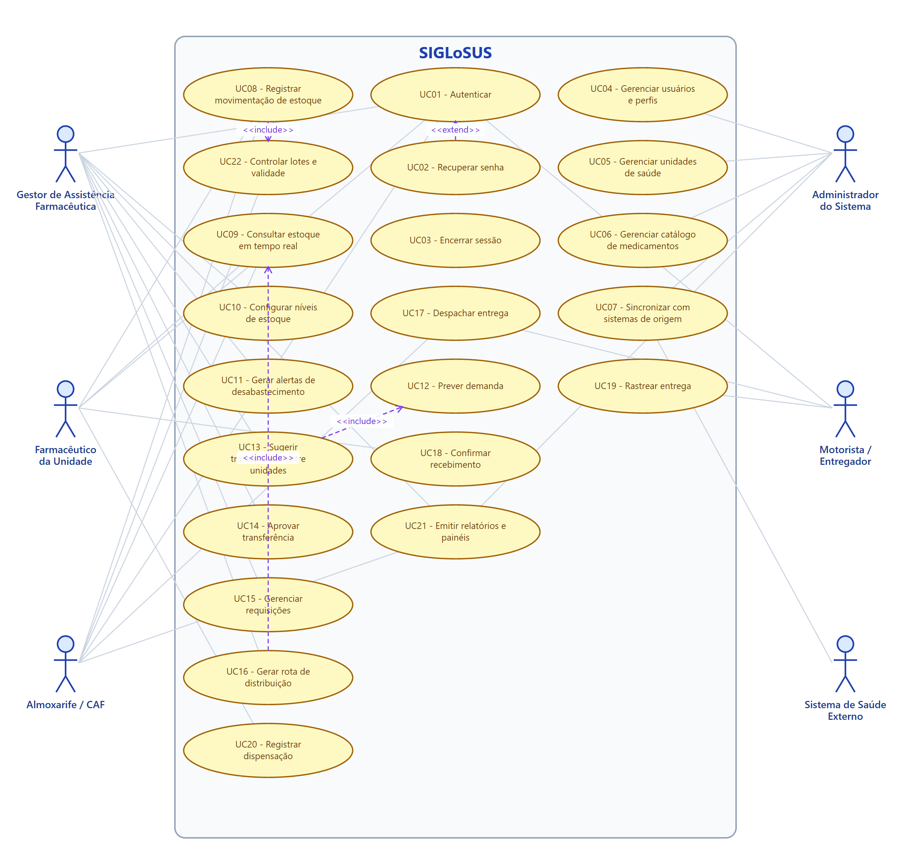
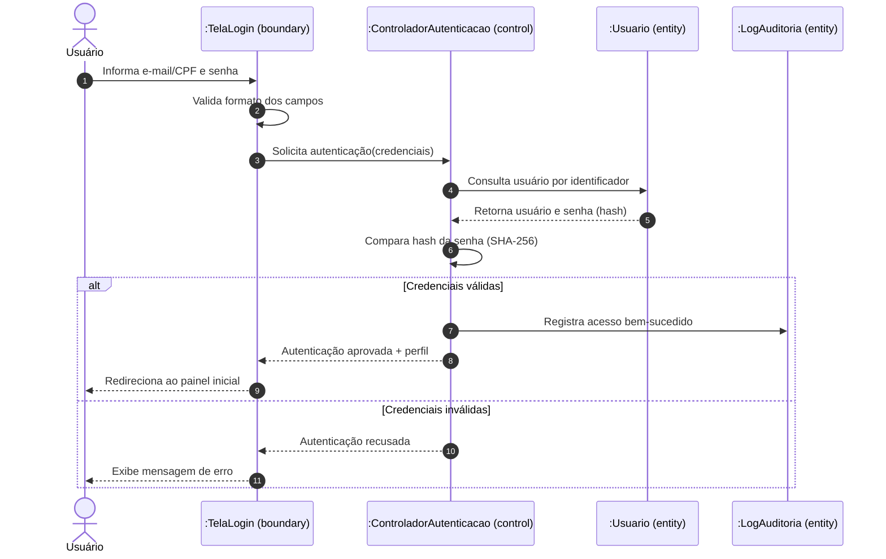
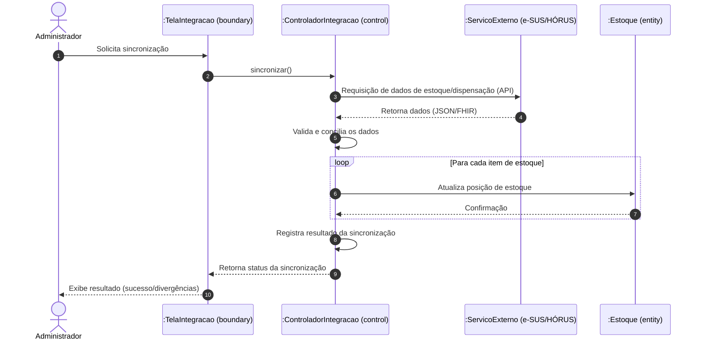
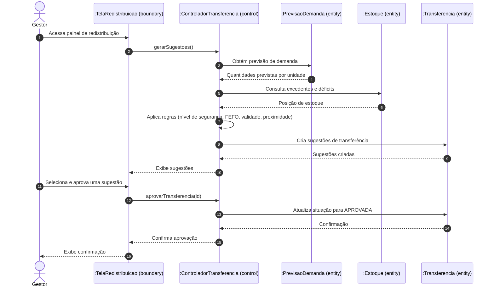
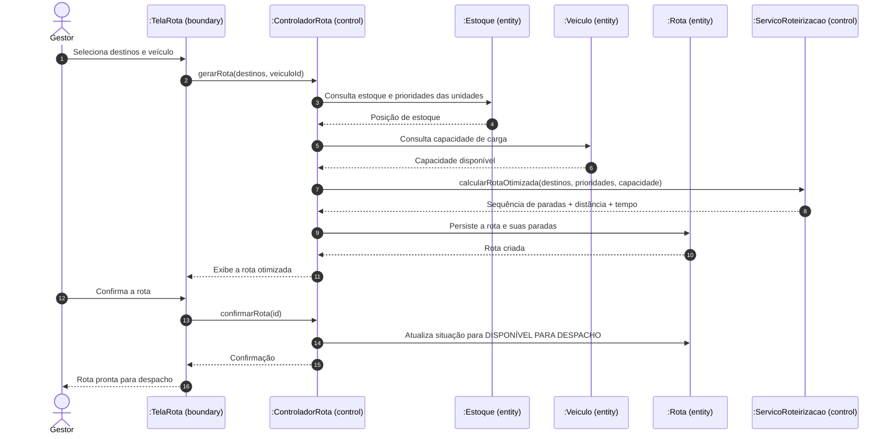
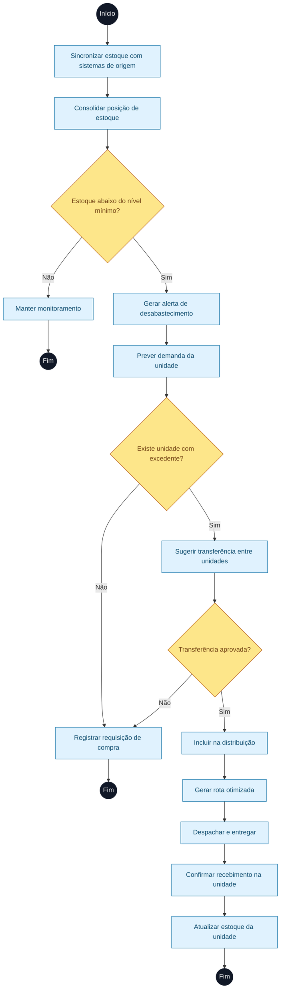
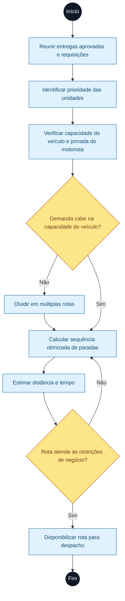
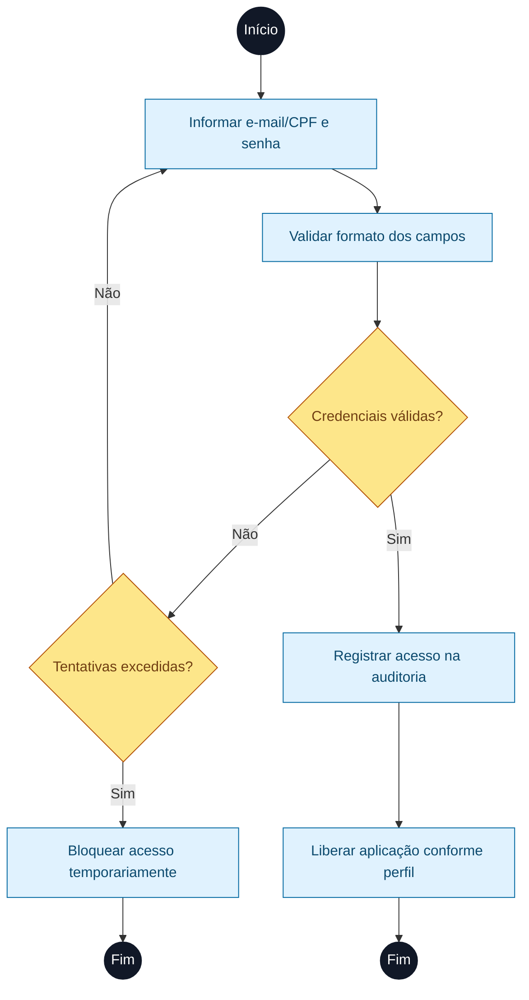
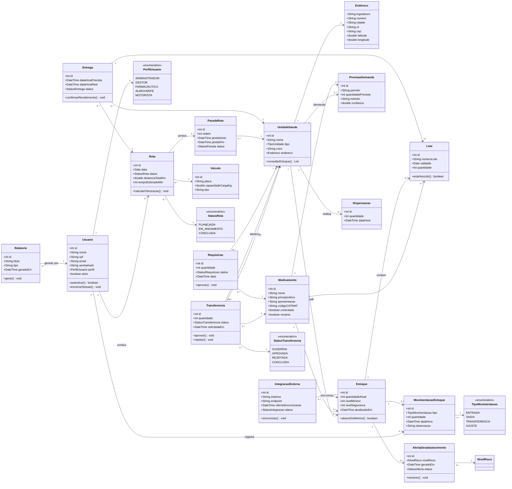

# Relatório Final – Projeto SIGLoSUS (Parte 1)

**Instituição:** Universidade Federal do Amazonas – UFAM / Instituto de Ciências Exatas e Tecnologia – ICET
**Disciplina:** Engenharia de Software
**Documento:** Relatório Final da Parte 1 (consolidação de todo o trabalho realizado)

---

## Apresentação

Este documento constitui o **relatório final da Parte 1** do projeto **SIGLoSUS**, desenvolvido para a disciplina de Engenharia de Software (UFAM/ICET). O relatório consolida **todo o trabalho realizado**: a compreensão do problema de logística de medicamentos no SUS, a elicitação e a padronização dos requisitos (funcionais, não-funcionais e regras de negócio) e a modelagem UML completa do sistema.

Além da narrativa do processo, este relatório incorpora a **documentação técnica final da Parte 1**, contemplando os itens solicitados: Introdução (Descrição Geral do Sistema e Descrição dos Usuários), Requisitos Gerais do Sistema e Diagramas UML (Casos de Uso, Especificação dos Casos de Uso, Sequência, Atividades e Classes).

## Contexto e Problema

A falta de medicamentos nas farmácias das unidades de saúde do SUS é um problema que afeta diretamente a vida do cidadão. Entre as principais causas estão a ausência de visão consolidada do estoque entre as unidades, os processos manuais e descentralizados, a dificuldade de prever a demanda e a ineficiência das rotas de distribuição.

A proposta do **SIGLoSUS** é integrar-se aos sistemas já utilizados pela rede (e-SUS APS, HÓRUS/SNA e BNAFAR) para oferecer uma visão em tempo real do estoque e, a partir dela, agir de forma proativa: prever a demanda, alertar sobre o risco de desabastecimento, sugerir transferências entre unidades e gerar rotas de distribuição otimizadas. O objetivo final não é apenas uma gestão de estoque eficiente, mas garantir que o medicamento esteja disponível quando e onde o paciente precisa — ou seja, **salvar vidas**.

## Objetivos

**Objetivo geral:** especificar um sistema de gestão logística de medicamentos para o SUS capaz de reduzir a falta de remédios nas farmácias.

**Objetivos específicos:**

- Definir a descrição geral do sistema e o perfil dos usuários;
- Elicitar e padronizar os requisitos funcionais, não-funcionais e as regras de negócio;
- Modelar o sistema em UML (casos de uso, especificação, sequência, atividades e classes).

## Metodologia e Processo de Trabalho

O trabalho foi conduzido a partir da análise dos materiais de referência disponibilizados na disciplina, seguindo as convenções neles definidas:

- **Modelo de Projeto – Padrão ISO:** definiu a estrutura do documento e o formato das tabelas de especificação de casos de uso;
- **Técnicas de Identificação e Escrita de Requisitos:** orientou a padronização dos RF e RNF (iniciados por "O sistema deve…"), a distinção das Regras de Negócio (políticas da organização) e a definição de prioridades (Essencial, Importante e Desejável);
- **Sintaxe de Caso de Uso:** forneceu a notação UML (atores em boneco palito, casos de uso em elipses, linhas de associação e setas `<<include>>` / `<<extend>>`);
- **Revisão de Programação Orientada a Objetos:** embasou a construção do diagrama de classes.

Os diagramas foram produzidos em notação UML e renderizados como imagens (SVG/PNG), sendo incorporados ao documento final. O diagrama de casos de uso foi gerado em **notação UML clássica**, e os demais (sequência, atividades e classes) por meio de ferramenta de diagramação a partir de código.

## Resultados Obtidos

A Parte 1 do projeto foi concluída com os seguintes artefatos:

- Introdução com a descrição geral do sistema (problema, proposta, escopo e fora de escopo) e a descrição de **6 perfis de usuários**;
- **22 Requisitos Funcionais** (RF01–RF22), **13 Requisitos Não-Funcionais** (RNF01–RNF13) e **9 Regras de Negócio** (RN01–RN09);
- **Diagrama de Casos de Uso** com 6 atores e 22 casos de uso, com relacionamentos `<<include>>` e `<<extend>>`;
- **Especificação detalhada de 7 casos de uso** principais;
- **4 Diagramas de Sequência**, **3 Diagramas de Atividades** e **1 Diagrama de Classes** com 18 classes e enumerações.

Todos os artefatos estão apresentados na íntegra na documentação técnica que compõe a segunda parte deste relatório.

## Considerações Finais

A modelagem produzida demonstra a viabilidade de um sistema que integra os dados já existentes na rede pública e transforma essa informação em ações concretas de reposição de estoque e distribuição. As próximas etapas do projeto (Parte 2) contemplam a arquitetura do sistema, os padrões de projeto, a prototipação das telas e a análise de riscos.

## Referências

- PRESSMAN, Roger S. *Engenharia de software: uma abordagem profissional*. Porto Alegre: AMGH, 2011.
- SOMMERVILLE, Ian. *Engenharia de software*. São Paulo: Pearson Addison-Wesley, 2011.
- BRASIL. Ministério da Saúde. Materiais de referência da disciplina de Engenharia de Software (UFAM/ICET), 2026.

---

# Documentação Técnica – Parte 1

# 1. Introdução

## 1.1. Descrição Geral do Sistema

O **SIGLoSUS** é um sistema de informação voltado à **gestão logística e à distribuição de medicamentos no âmbito do Sistema Único de Saúde (SUS)**. Ele nasce de um problema concreto e recorrente na rede pública: a **falta de medicamentos nas farmácias** (desabastecimento), causada, entre outros fatores, pela **ausência de visão consolidada do estoque** entre as unidades, por **processos manuais e descentralizados**, pela **dificuldade de prever a demanda** e por **rotas de distribuição ineficientes**.

O sistema **não substitui** as ferramentas já utilizadas pela gestão de saúde — ele **integra-se a elas** (por exemplo, **e-SUS APS**, **HÓRUS/SNA** e **BNAFAR**) para consolidar dados de estoque e dispensação em uma **única visão em tempo real**. A partir dessa visão, o SIGLoSUS passa a agir de forma **proativa**:

- **Prevê a demanda** de cada medicamento por unidade, com base no histórico de consumo;
- **Antecipa o risco de desabastecimento** e emite alertas antes que a falta aconteça;
- **Sugere transferências** entre unidades com excedente e unidades com déficit;
- **Gera rotas de distribuição otimizadas**, para que o medicamento chegue mais rápido e a um custo menor;
- **Rastreia as entregas** até a confirmação de recebimento na ponta.

O objetivo final não é apenas ter uma gestão de estoque eficiente: é **garantir que o medicamento esteja disponível quando e onde o paciente precisa**, reduzindo a falta de remédios nas farmácias e, com isso, **salvando vidas**.

**Escopo do sistema (o que está contemplado):**
- Gestão do estoque de medicamentos de uma **região de saúde**, da **Central de Abastecimento Farmacêutico (CAF)** até as unidades de ponta (UBS, hospitais, farmácias populares);
- Integração com os sistemas de saúde já existentes;
- Previsão de demanda, alertas, redistribuição e roteirização;
- Rastreamento de entregas e controle de lotes/validade;
- Relatórios e painéis gerenciais.

**Fora do escopo (o que NÃO está contemplado nesta versão):**
- Prontuário eletrônico e prescrição médica (o sistema apenas recebe o registro de dispensação);
- Compras públicas/licitações (o sistema registra a requisição, mas não realiza o processo licitatório);
- Aplicativos para o cidadão/paciente.

## 1.2. Descrição dos Usuários

Os usuários do SIGLoSUS são classificados conforme o perfil de atuação na cadeia de assistência farmacêutica. Cada perfil possui responsabilidades e níveis de acesso distintos.

| Perfil (Ator) | Descrição | Principais responsabilidades no sistema |
|---|---|---|
| **Gestor de Assistência Farmacêutica** | Profissional responsável pela gestão da assistência farmacêutica na região de saúde. | Acompanha painéis, aprova transferências e requisições, configura parâmetros de estoque, analisa previsões e relatórios. |
| **Farmacêutico da Unidade** | Farmacêutico responsável pelo estoque e pela dispensação em uma unidade de saúde (UBS/hospital). | Consulta o estoque da unidade, registra movimentações e dispensações, confirma recebimentos e sinaliza necessidades. |
| **Almoxarife / Responsável pela CAF** | Profissional que opera a Central de Abastecimento Farmacêutico. | Registra entradas e saídas, atende requisições, prepara e despacha entregas, controla lotes e validade. |
| **Motorista / Entregador** | Profissional que realiza a distribuição física dos medicamentos. | Visualiza a rota, confirma a saída, registra a entrega e reporta ocorrências; opera em modo offline. |
| **Administrador do Sistema** | Profissional de TI responsável pela manutenção técnica e pela configuração do sistema. | Gerencia usuários e perfis, configura integrações, monitora sincronizações e a auditoria. |
| **Sistema de Saúde Externo** *(ator secundário)* | Sistemas já utilizados pela rede (e-SUS APS, HÓRUS/SNA, BNAFAR). | Fornecem e recebem dados de estoque e dispensação por meio de integração/API. |

---

# 2. Requisitos Gerais do Sistema

> **Convenções de escrita (conforme material de referência):**
> - **Requisitos Funcionais (RF)** e **Requisitos Não-Funcionais (RNF)** são escritos no infinitivo, iniciando por *"O sistema deve…"*.
> - **Regras de Negócio (RN)** descrevem **políticas/condições da organização**, não iniciam com *"O sistema deve…"* e não citam as palavras sistema, software ou aplicativo.
> - **Prioridades:** *Essencial* (sem ele o sistema não funciona), *Importante* (funciona, mas de forma insatisfatória) e *Desejável* (pode ficar para versões futuras).

## 2.1. Requisitos Funcionais

| Identificador | Descrição | Escopo | Prioridade |
|---|---|---|---|
| **RF01** | O sistema deve permitir o acesso do usuário por meio de login e senha. | Geral | Essencial |
| **RF02** | O sistema deve permitir que o usuário recupere a senha esquecida. | Geral | Importante |
| **RF03** | O sistema deve permitir a saída do usuário (logout). | Geral | Importante |
| **RF04** | O sistema deve permitir o cadastro, a edição e a inativação de usuários, atribuindo-lhes perfis de acesso. | Administração | Essencial |
| **RF05** | O sistema deve permitir o cadastro e a manutenção das unidades de saúde (UBS, hospitais e centros de distribuição). | Cadastros | Essencial |
| **RF06** | O sistema deve permitir o cadastro e a manutenção do catálogo de medicamentos (nome, princípio ativo, apresentação, código CATMAT e indicação de controlado). | Cadastros | Essencial |
| **RF07** | O sistema deve integrar-se, por meio de API, aos sistemas de saúde já utilizados (e-SUS APS, HÓRUS/SNA e BNAFAR) para importar e exportar dados de estoque e de dispensação. | Integração | Essencial |
| **RF08** | O sistema deve registrar todas as movimentações de estoque (entradas, saídas, transferências e ajustes), vinculando o lote e o usuário responsável. | Estoque | Essencial |
| **RF09** | O sistema deve consolidar e apresentar, em tempo real, a posição de estoque de cada medicamento em cada unidade. | Estoque | Essencial |
| **RF10** | O sistema deve permitir a configuração dos níveis mínimo e de segurança de estoque por medicamento e por unidade. | Estoque | Essencial |
| **RF11** | O sistema deve gerar alertas automáticos de risco de desabastecimento quando o estoque atingir o nível mínimo configurado. | Monitoramento | Essencial |
| **RF12** | O sistema deve prever a demanda de cada medicamento por unidade e por período, com base no histórico de consumo. | Inteligência | Importante |
| **RF13** | O sistema deve sugerir transferências de medicamentos entre unidades com excedente e unidades com déficit. | Distribuição | Essencial |
| **RF14** | O sistema deve permitir que o gestor aprove ou rejeite as transferências sugeridas. | Distribuição | Essencial |
| **RF15** | O sistema deve gerar rotas de distribuição otimizadas, considerando a distância, a prioridade das unidades e a capacidade do veículo. | Distribuição | Essencial |
| **RF16** | O sistema deve permitir o despacho e o acompanhamento das entregas em tempo real. | Distribuição | Importante |
| **RF17** | O sistema deve permitir a confirmação de recebimento da entrega pela unidade de destino. | Distribuição | Essencial |
| **RF18** | O sistema deve controlar lotes e datas de validade, aplicando a regra de saída por validade. | Estoque | Essencial |
| **RF19** | O sistema deve permitir o registro da dispensação de medicamentos ao paciente. | Assistência | Importante |
| **RF20** | O sistema deve gerenciar as requisições de medicamentos enviadas pelas unidades ao centro de distribuição. | Distribuição | Essencial |
| **RF21** | O sistema deve emitir relatórios e painéis gerenciais (dashboards) de estoque, consumo, desabastecimento e entregas. | Gestão | Importante |
| **RF22** | O sistema deve registrar logs de auditoria de todas as operações críticas realizadas pelos usuários. | Segurança | Essencial |

## 2.2. Requisitos Não-Funcionais

| Identificador | Descrição | Categoria | Escopo | Prioridade |
|---|---|---|---|---|
| **RNF01** | O sistema deve criptografar as senhas dos usuários e os dados sensíveis, tanto em trânsito (TLS) quanto em repouso. | Segurança | Geral | Essencial |
| **RNF02** | O sistema deve tratar os dados pessoais em conformidade com a Lei Geral de Proteção de Dados (LGPD). | Segurança / Conformidade | Geral | Essencial |
| **RNF03** | O sistema deve responder às consultas de estoque em tempo real em até 2 segundos. | Desempenho | Estoque | Essencial |
| **RNF04** | O sistema deve calcular e apresentar uma rota otimizada em até 60 segundos. | Desempenho | Distribuição | Importante |
| **RNF05** | O sistema deve estar disponível 99,5% do tempo, de forma contínua (24 horas por dia, 7 dias por semana). | Disponibilidade | Geral | Essencial |
| **RNF06** | O sistema deve apresentar interface responsiva, de fácil uso e acessível, atendendo ao nível AA das diretrizes WCAG 2.1. | Usabilidade / Acessibilidade | Geral | Importante |
| **RNF07** | O sistema deve disponibilizar interfaces de programação (APIs REST) e adotar o padrão HL7 FHIR para interoperabilidade com os sistemas de saúde. | Interoperabilidade | Integração | Essencial |
| **RNF08** | O sistema deve suportar, no mínimo, 500 unidades de saúde e 5.000 usuários simultâneos sem degradação. | Escalabilidade | Geral | Importante |
| **RNF09** | O sistema deve garantir a integridade das operações de estoque por meio de transações consistentes (tudo ou nada). | Confiabilidade | Estoque | Essencial |
| **RNF10** | O sistema deve manter os registros de auditoria por, no mínimo, 5 anos. | Auditabilidade | Segurança | Importante |
| **RNF11** | O sistema deve funcionar nos principais navegadores modernos e em dispositivos móveis. | Portabilidade | Geral | Importante |
| **RNF12** | O sistema deve ser construído de forma modular e documentada, com testes automatizados que garantam sua manutenibilidade. | Manutenibilidade | Geral | Importante |
| **RNF13** | O aplicativo do motorista deve operar em modo offline e sincronizar automaticamente quando houver conexão. | Disponibilidade | Distribuição | Importante |

## 2.3. Regras de Negócio

| Identificador | Descrição | Escopo | Prioridade |
|---|---|---|---|
| **RN01** | Um medicamento só pode ser transferido de uma unidade que possua estoque acima do seu nível de segurança. | Estoque | Essencial |
| **RN02** | A distribuição e a dispensação de medicamentos devem seguir a regra FEFO (*First Expired, First Out*): o primeiro que expira é o primeiro que sai. | Estoque | Essencial |
| **RN03** | Medicamentos com validade inferior a 90 dias não podem ser transferidos entre unidades. | Estoque | Importante |
| **RN04** | Unidades com estoque abaixo do nível mínimo têm prioridade no recebimento de entregas. | Distribuição | Essencial |
| **RN05** | Medicamentos sujeitos a controle especial (Portaria SVS/MS nº 344/98) exigem rastreabilidade por lote e conferência por dois responsáveis. | Assistência | Essencial |
| **RN06** | O abastecimento deve priorizar os medicamentos da RENAME (componente básico da assistência farmacêutica). | Distribuição | Importante |
| **RN07** | As rotas de entrega devem respeitar a capacidade de carga do veículo e a jornada de trabalho do motorista. | Distribuição | Essencial |
| **RN08** | Transferências entre unidades devem priorizar as unidades mais próximas, a fim de reduzir custo e tempo de entrega. | Distribuição | Importante |
| **RN09** | Requisições acima do limite de valor definido pela gestão exigem aprovação do gestor de assistência farmacêutica. | Gestão | Importante |

---

# 3. Diagramas UML

## 3.1. Diagrama de Casos de Uso

O diagrama abaixo apresenta os atores, os casos de uso do SIGLoSUS e os relacionamentos de **`<<include>>`** (obrigatório) e **`<<extend>>`** (opcional). Todos os casos de uso estão associados a pelo menos um requisito funcional e mantêm linha de interação com o ator.

**Legenda:**
- **Atores:** representados pelos perfis que interagem com o sistema;
- **Retângulo "SIGLoSUS":** agrupa os casos de uso do sistema (evita poluição visual);
- **`<<include>>`:** um caso de uso **dispara obrigatoriamente** outro (dependência);
- **`<<extend>>`:** um caso de uso **opcional** ocorre dentro do contexto de outro.

**Figura 1 – Diagrama de Casos de Uso do SIGLoSUS.**

> **Observação sobre as dependências (`<<include>>`):**
> - **UC13 (Sugerir transferência)** depende de **UC12 (Prever demanda)** — só é possível sugerir a redistribuição conhecendo a demanda futura.
> - **UC16 (Gerar rota)** depende de **UC09 (Consultar estoque em tempo real)** — a rota é montada a partir da posição consolidada de estoque.
> - **UC08 (Registrar movimentação)** depende de **UC22 (Controlar lotes e validade)** — toda movimentação respeita a regra FEFO.

## 3.2. Especificação dos Casos de Uso

### UC01 – Autenticar

| Campo | Descrição |
|---|---|
| **Nome do caso de uso** | UC01 – Autenticar |
| **Caso de uso geral** | Fluxo Principal |
| **Ator principal** | Usuário (qualquer perfil) |
| **Atores secundários** | N/A |
| **Resumo** | Descreve as etapas de acesso do usuário ao sistema por meio de login e senha. |
| **Pré-condições** | O usuário deve possuir cadastro ativo e acesso à internet. |
| **Pós-condições** | Sendo os dados válidos, o usuário é redirecionado ao painel inicial conforme o seu perfil. |

| Ações do Ator | Ações do Sistema |
|---|---|
| 1 – Informar e-mail (ou CPF) e senha | |
| | 2 – Validar as credenciais informadas |
| | 3 – Verificar o perfil de acesso do usuário |
| 4 – Confirmar o acesso | |
| | 5 – Registrar o acesso no log de auditoria e liberar a aplicação |

| Restrições/Validações |
|---|
| Se as credenciais forem inválidas, o acesso não é concedido. |
| O acesso é bloqueado temporariamente após 5 tentativas incorretas. |

**Tabela 1 – Especificação do caso de uso Autenticar.**

---

### UC07 – Sincronizar com sistemas de origem

| Campo | Descrição |
|---|---|
| **Nome do caso de uso** | UC07 – Sincronizar com sistemas de origem |
| **Caso de uso geral** | Fluxo Principal |
| **Ator principal** | Administrador do Sistema |
| **Atores secundários** | Sistema de Saúde Externo (e-SUS APS, HÓRUS/SNA, BNAFAR) |
| **Resumo** | Descreve a integração do SIGLoSUS com os sistemas já utilizados pela rede para importar/exportar dados de estoque e dispensação. |
| **Pré-condições** | As integrações devem estar configuradas e os serviços externos disponíveis. |
| **Pós-condições** | Os dados de estoque e dispensação são consolidados e ficam disponíveis para consulta em tempo real. |

| Ações do Ator | Ações do Sistema |
|---|---|
| 1 – Solicitar a sincronização (manual ou agendada) | |
| | 2 – Consultar os sistemas externos via API |
| | 3 – Receber os dados de estoque e dispensação |
| | 4 – Validar e conciliar os dados recebidos |
| | 5 – Atualizar a base consolidada de estoque |
| | 6 – Registrar o resultado e possíveis divergências da sincronização |

| Restrições/Validações |
|---|
| Se um sistema externo estiver indisponível, a última sincronização válida é mantida e o erro é registrado. |
| Dados divergentes são sinalizados para conferência manual. |

**Tabela 2 – Especificação do caso de uso Sincronizar com sistemas de origem.**

---

### UC09 – Consultar estoque em tempo real

| Campo | Descrição |
|---|---|
| **Nome do caso de uso** | UC09 – Consultar estoque em tempo real |
| **Caso de uso geral** | Fluxo Principal |
| **Ator principal** | Farmacêutico / Almoxarife / Gestor |
| **Atores secundários** | N/A |
| **Resumo** | Descreve a consulta consolidada da posição de estoque por medicamento e por unidade. |
| **Pré-condições** | O usuário deve estar autenticado e possuir dados de estoque sincronizados. |
| **Pós-condições** | O sistema apresenta a posição de estoque atualizada e os respectivos alertas. |

| Ações do Ator | Ações do Sistema |
|---|---|
| 1 – Selecionar filtros (medicamento, unidade, período) | |
| | 2 – Recuperar os dados consolidados de estoque |
| | 3 – Calcular a situação em relação aos níveis mínimo e de segurança |
| | 4 – Apresentar a posição de estoque e os alertas associados |

| Restrições/Validações |
|---|
| A consulta deve refletir a última sincronização realizada. |
| Medicamentos abaixo do nível mínimo são destacados visualmente. |

**Tabela 3 – Especificação do caso de uso Consultar estoque em tempo real.**

---

### UC13 – Sugerir transferência entre unidades

| Campo | Descrição |
|---|---|
| **Nome do caso de uso** | UC13 – Sugerir transferência entre unidades |
| **Caso de uso geral** | Fluxo Principal |
| **Ator principal** | Gestor de Assistência Farmacêutica |
| **Atores secundários** | N/A |
| **Resumo** | Descreve a geração automática de sugestões de redistribuição de medicamentos entre unidades com excedente e unidades com déficit. |
| **Pré-condições** | O estoque deve estar sincronizado e a previsão de demanda deve ter sido calculada (UC12). |
| **Pós-condições** | As sugestões de transferência ficam disponíveis para aprovação. |

| Ações do Ator | Ações do Sistema |
|---|---|
| 1 – Acessar o painel de redistribuição | |
| | 2 – Identificar unidades com excedente e unidades com déficit |
| | 3 – Verificar as regras de negócio (nível de segurança, FEFO, validade, proximidade) |
| | 4 – Calcular e apresentar as sugestões de transferência |
| 5 – Selecionar a sugestão desejada | |
| | 6 – Encaminhar a sugestão para aprovação (UC14) |

| Restrições/Validações |
|---|
| Não pode ser sugerida transferência de unidade com estoque abaixo do nível de segurança (RN01). |
| Medicamentos com validade inferior a 90 dias não podem ser transferidos (RN03). |

**Tabela 4 – Especificação do caso de uso Sugerir transferência entre unidades.**

---

### UC14 – Aprovar transferência

| Campo | Descrição |
|---|---|
| **Nome do caso de uso** | UC14 – Aprovar transferência |
| **Caso de uso geral** | Fluxo Principal |
| **Ator principal** | Gestor de Assistência Farmacêutica |
| **Atores secundários** | N/A |
| **Resumo** | Descreve a análise e a aprovação (ou rejeição) de uma transferência sugerida. |
| **Pré-condições** | Deve existir ao menos uma sugestão de transferência pendente. |
| **Pós-condições** | Aprovada, a transferência é registrada e passa a compor as entregas a serem roteirizadas. |

| Ações do Ator | Ações do Sistema |
|---|---|
| 1 – Analisar a sugestão de transferência | |
| 2 – Aprovar ou rejeitar a sugestão | |
| | 3 – Validar as regras de negócio aplicáveis |
| | 4 – Registrar a decisão e atualizar a situação da transferência |
| | 5 – Notificar as unidades envolvidas |

| Restrições/Validações |
|---|
| A aprovação exige a conferência das regras de negócio (RN01, RN03, RN08). |
| Uma transferência rejeitada retorna ao painel com a justificativa. |

**Tabela 5 – Especificação do caso de uso Aprovar transferência.**

---

### UC16 – Gerar rota de distribuição

| Campo | Descrição |
|---|---|
| **Nome do caso de uso** | UC16 – Gerar rota de distribuição |
| **Caso de uso geral** | Fluxo Principal |
| **Ator principal** | Gestor de Assistência Farmacêutica |
| **Atores secundários** | Almoxarife / CAF |
| **Resumo** | Descreve a geração de uma rota otimizada para a distribuição dos medicamentos até as unidades de destino. |
| **Pré-condições** | Deve haver transferências aprovadas ou requisições a entregar; veículo e motorista devem estar definidos. |
| **Pós-condições** | A rota é gerada, sequenciando as paradas, e fica disponível para despacho. |

| Ações do Ator | Ações do Sistema |
|---|---|
| 1 – Selecionar as unidades de destino e o veículo | |
| | 2 – Recuperar a posição de estoque e as prioridades (UC09) |
| | 3 – Calcular a melhor sequência de paradas (distância, prioridade, capacidade) |
| | 4 – Apresentar a rota com distância e tempo estimados |
| 5 – Confirmar a rota | |
| | 6 – Disponibilizar a rota para o despacho (UC17) |

| Restrições/Validações |
|---|
| A rota deve respeitar a capacidade de carga do veículo e a jornada do motorista (RN07). |
| Unidades com estoque abaixo do mínimo têm prioridade (RN04). |

**Tabela 6 – Especificação do caso de uso Gerar rota de distribuição.**

---

### UC18 – Confirmar recebimento

| Campo | Descrição |
|---|---|
| **Nome do caso de uso** | UC18 – Confirmar recebimento |
| **Caso de uso geral** | Fluxo Principal |
| **Ator principal** | Farmacêutico da Unidade |
| **Atores secundários** | Motorista / Entregador |
| **Resumo** | Descreve a conferência e a confirmação de que os medicamentos entregues foram recebidos pela unidade de destino. |
| **Pré-condições** | Deve existir uma entrega despachada para a unidade. |
| **Pós-condições** | O recebimento é registrado, o estoque da unidade é atualizado e a entrega é finalizada. |

| Ações do Ator | Ações do Sistema |
|---|---|
| 1 – Conferir os itens e os lotes entregues | |
| | 2 – Apresentar os itens previstos na entrega |
| 3 – Confirmar o recebimento (ou registrar divergência) | |
| | 4 – Atualizar o estoque da unidade de destino |
| | 5 – Encerrar a entrega e atualizar a situação da rota |

| Restrições/Validações |
|---|
| Havendo divergência de itens ou lotes, o recebimento é registrado com pendência e o gestor é notificado. |

**Tabela 7 – Especificação do caso de uso Confirmar recebimento.**

## 3.3. Diagramas de Sequência

Os diagramas de sequência detalham a interação entre os atores e os objetos do sistema nos casos de uso principais, seguindo o padrão **boundary → control → entity**.

### 3.3.1. Sequência – UC01 Autenticar

**Figura 2 – Sequência Autenticar.**

### 3.3.2. Sequência – UC07 Sincronizar com sistemas de origem

**Figura 3 – Sequência Sincronizar com sistemas de origem.**

### 3.3.3. Sequência – UC13/UC14 Sugerir e Aprovar Transferência

**Figura 4 – Sequência Sugerir e Aprovar Transferência.**

### 3.3.4. Sequência – UC16 Gerar rota de distribuição

**Figura 5 – Sequência Gerar rota de distribuição.**

## 3.4. Diagramas de Atividades

### 3.4.1. Atividade – Monitoramento e reposição de estoque

**Figura 6 – Atividade Monitoramento e reposição de estoque.**

### 3.4.2. Atividade – Geração de rota de distribuição

**Figura 7 – Atividade Geração de rota de distribuição.**

### 3.4.3. Atividade – Autenticação

**Figura 8 – Atividade Autenticação.**

## 3.5. Diagrama de Classes

O diagrama de classes abaixo representa a estrutura estática do SIGLoSUS, com suas principais entidades, atributos, métodos e relacionamentos.

**Figura 9 – Diagrama de Classes do SIGLoSUS.**

---

*Fim da Parte 1 — Documento de Especificação de Requisitos e Modelagem UML do SIGLoSUS.*
