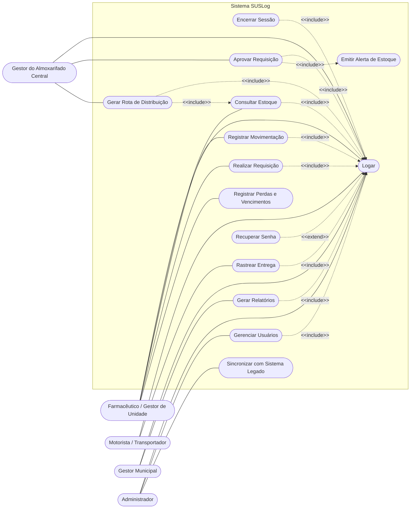
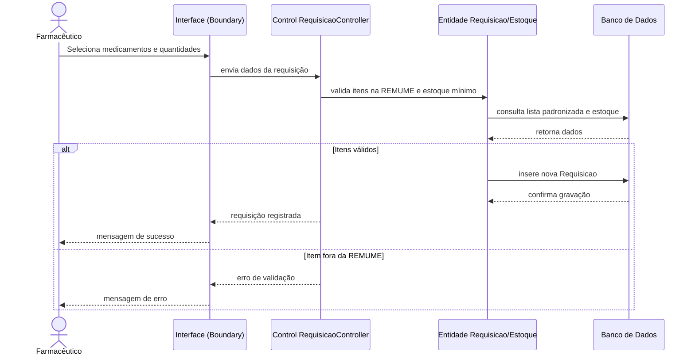
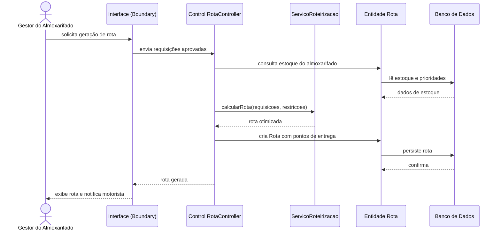
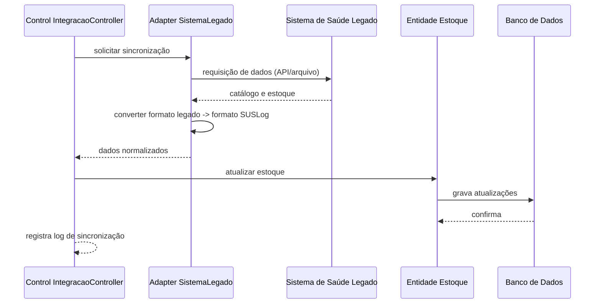
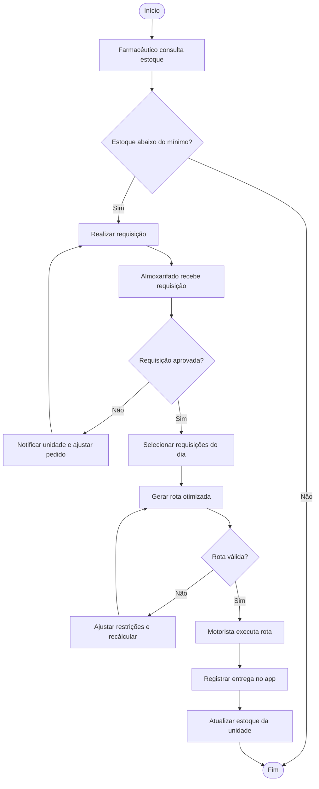
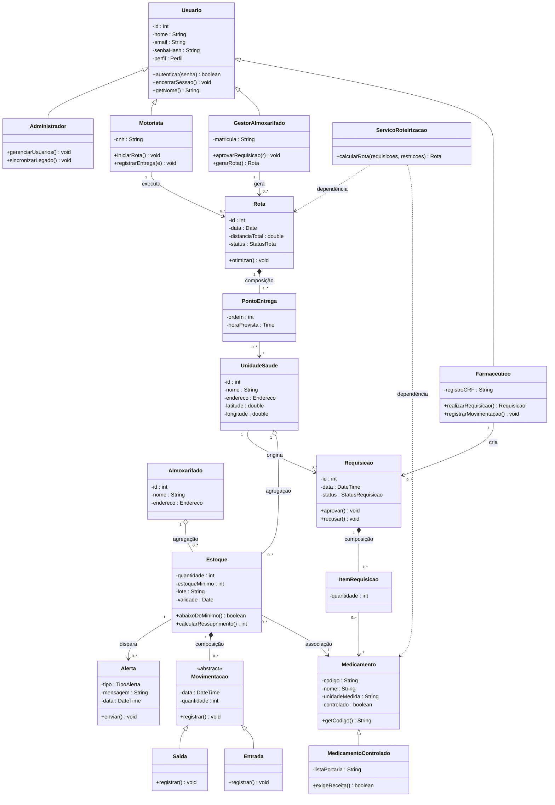
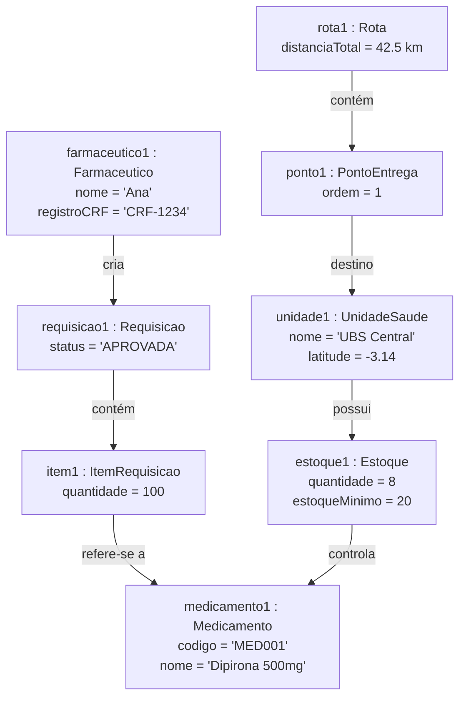

# Universidade Federal do Amazonas – UFAM
## Instituto de Ciências Exatas e Tecnologia – ICET
### Engenharia de Software

> **Nota de vigência.** Este documento é o **escopo inicial** (Parte 1) do projeto e preserva a
> numeração original dos requisitos (14 RF, 10 RNF). A especificação **oficial e atualizada**,
> usada em toda a implementação e nos diagramas das Partes 1 e 2, é o documento consolidado
> `pasta 02/docs/Documentacao_SIGLoSUS_Parte2.md` (seções 1 a 6, versão 2.1.0), que refina
> e renumera os requisitos (22 RF, 13 RNF, 9 RN). O mapeamento entre as numerações está
> registrado na seção 2.1 da documentação consolidada.

<br><br><br>

# SUSLog
### Sistema Inteligente de Logística e Gestão de Estoque de Medicamentos do SUS

<br><br><br>

**Itacoatiara/AM**
**2026**

---

## Ficha Técnica

**Equipe Responsável pela Elaboração**

| Desenvolvedor | Papel |
|---|---|
| Desenvolvedor 1 | Analista de Requisitos / Documentação |
| Desenvolvedor 2 | Modelagem UML e POO |
| Desenvolvedor 3 | Arquitetura e Integração |
| Desenvolvedor 4 | Prototipação e Análise de Riscos |

**Público Alvo**

Este documento destina-se a todos os colaboradores inseridos na execução do projeto, bem como ao cliente (Secretaria Municipal de Saúde / gestores de unidades) que receberá o produto final.

---

## Registro de Alterações

| Versão | Responsável | Data | Alterações |
|---|---|---|---|
| 1.0 | Desenvolvedor 1 | 11/11/2026 | Criação do escopo inicial e levantamento de requisitos (RF, RNF, RN). |
| 1.1 | Desenvolvedor 2 | 11/11/2026 | Construção dos diagramas UML (casos de uso, sequência, atividades, classes e objetos). |

---

## Sumário

1. Introdução
2. Requisitos Gerais do Sistema
3. Diagramas UML
4. Arquitetura do Sistema
5. Padrões de Projeto
6. Prototipação das Telas
7. Análise de Risco
8. Apêndice

---

# 1. Introdução

## 1.1. Estrutura / Visão Geral do Documento

Esta introdução fornece as informações necessárias para fazer um bom uso deste documento, explicitando seus objetivos e as convenções adotadas no texto. As demais seções apresentam a especificação do sistema **SUSLog** e estão organizadas conforme descrito abaixo:

- **Seção 1 – Introdução:** visão geral do documento, audiência, convenções, descrição geral do sistema e descrição dos usuários.
- **Seção 2 – Requisitos Gerais do Sistema:** requisitos funcionais (RF), requisitos não funcionais (RNF) e regras de negócio (RN).
- **Seção 3 – Diagramas UML:** diagramas de casos de uso, especificação textual dos casos de uso, diagramas de sequência, de atividades, de classes e de objetos.
- **Seção 4 – Arquitetura do Sistema:** visão da arquitetura lógica e de integração.
- **Seção 5 – Padrões de Projeto:** padrões de projeto (design patterns) adotados.
- **Seção 6 – Prototipação das Telas:** protótipos de baixa fidelidade das principais telas.
- **Seção 7 – Análise de Risco:** identificação e tratamento dos riscos do projeto.
- **Seção 8 – Apêndice:** informações complementares e histórico de versões.

## 1.2. Audiência do Documento

| Público | Interesse no documento |
|---|---|
| Equipe de desenvolvimento | Entender e implementar os requisitos e a modelagem do sistema. |
| Docente / Avaliador (ICET-UFAM) | Avaliar a especificação segundo o padrão ISO e os conteúdos de Engenharia de Software. |
| Gestores da Secretaria de Saúde | Validar se o sistema atende às necessidades reais da logística de medicamentos. |
| Farmacêuticos e gestores de unidades | Conhecer as funcionalidades de estoque e requisição. |
| Equipe de integração | Compreender como o sistema se integra ao sistema de saúde vigente. |

## 1.3. Convenções, Termos e Abreviações

| Sigla/Termo | Significado |
|---|---|
| RF | Requisito Funcional |
| RNF | Requisito Não Funcional |
| RN | Regra de Negócio |
| UC | Caso de Uso |
| SUS | Sistema Único de Saúde |
| UBS | Unidade Básica de Saúde |
| CAF | Central de Abastecimento Farmacêutico |
| REMUME | Relação Municipal de Medicamentos Essenciais |
| RENAME | Relação Nacional de Medicamentos Essenciais |
| FEFO | *First Expired, First Out* (primeiro que vence, primeiro que sai) |
| LGPD | Lei Geral de Proteção de Dados |
| API | *Application Programming Interface* |
| e-SUS APS | Sistema oficial de Atenção Primária à Saúde |

## 1.4. Descrição Geral do Sistema

O **SUSLog** é um sistema de informação voltado para a **logística de medicamentos do SUS**. O problema central que ele resolve é a **falta de medicamentos nas unidades de saúde**, causada por estoques mal distribuídos, ausência de visão consolidada e rotas de entrega ineficientes.

O sistema **integra-se diretamente ao sistema de saúde vigente** (ex.: e-SUS APS / HÓRUS / sistema legado da Secretaria), importando e sincronizando os dados já existentes, e passa a oferecer:

1. **Visão consolidada de estoque** em tempo real, por unidade e por medicamento;
2. **Alertas de desabastecimento** e de vencimento;
3. **Requisições de medicamentos** entre unidades e o almoxarifado central;
4. **Geração automática de rotas otimizadas** de distribuição, para que o medicamento chegue mais rápido a quem precisa;
5. **Rastreamento das entregas** e **relatórios gerenciais** para a tomada de decisão.

O objetivo final não é apenas uma gestão de estoque eficiente: é **garantir que o medicamento esteja disponível quando o paciente chegar**, contribuindo diretamente para **salvar vidas**.

## 1.5. Descrição dos Usuários

Os usuários deste sistema podem ser classificados em:

- **Farmacêutico / Gestor de Unidade de Saúde:** profissional responsável pelo estoque da UBS. Consulta a visão de estoque, registra movimentações e realiza requisições de medicamentos ao almoxarifado central.
- **Gestor do Almoxarifado Central (CAF):** responsável por consolidar as requisições das unidades, aprovar pedidos e disparar a distribuição.
- **Motorista / Transportador:** responsável por executar as rotas de entrega geradas pelo sistema e registrar a entrega no aplicativo móvel.
- **Gestor Municipal (Secretaria de Saúde):** acompanha indicadores de desabastecimento, perdas e desempenho logístico para a tomada de decisão.
- **Administrador do Sistema:** gerencia usuários, perfis de acesso, parâmetros de estoque e a integração com o sistema legado.
- **Sistema de Saúde Legado (ator secundário):** sistema externo com o qual o SUSLog troca dados de estoque e de catálogo de medicamentos.

---

# 2. Requisitos Gerais do Sistema

## 2.1. Requisitos Funcionais

| Identificador | Descrição | Escopo | Prioridade |
|---|---|---|---|
| RF01 | O sistema deve permitir o acesso do usuário por meio de login. | Geral | Essencial |
| RF02 | O sistema deve permitir a saída do usuário (logout). | Geral | Importante |
| RF03 | O sistema deve permitir o cadastro e a gestão de usuários com perfis de acesso distintos. | Geral | Essencial |
| RF04 | O sistema deve integrar-se ao sistema de saúde vigente para importar e sincronizar dados de catálogo e de estoque de medicamentos. | Integração | Essencial |
| RF05 | O sistema deve registrar e exibir, em tempo real, o estoque de medicamentos de cada unidade de saúde. | Estoque | Essencial |
| RF06 | O sistema deve emitir alertas automáticos quando o estoque de um medicamento atingir o nível mínimo ou crítico. | Estoque | Essencial |
| RF07 | O sistema deve permitir o registro de entradas e saídas (movimentações) de medicamentos. | Estoque | Essencial |
| RF08 | O sistema deve permitir que a unidade de saúde realize a requisição de medicamentos ao almoxarifado central. | Requisição | Essencial |
| RF09 | O sistema deve permitir que o almoxarifado central aprove, recuse ou ajuste as requisições recebidas. | Requisição | Importante |
| RF10 | O sistema deve gerar automaticamente rotas de distribuição otimizadas entre o almoxarifado central e as unidades de saúde. | Logística | Essencial |
| RF11 | O sistema deve permitir o rastreamento da entrega dos medicamentos em tempo real. | Logística | Importante |
| RF12 | O sistema deve permitir o registro de perdas, vencimentos e devoluções de medicamentos. | Estoque | Importante |
| RF13 | O sistema deve gerar relatórios gerenciais e painéis (dashboards) de consumo, desabastecimento e desempenho logístico. | Relatórios | Importante |
| RF14 | O sistema deve notificar os responsáveis sobre demandas críticas, aprovações e status de rotas. | Notificação | Desejável |

## 2.2. Requisitos Não-Funcionais

| Identificador | Descrição | Categoria | Escopo | Prioridade |
|---|---|---|---|---|
| RNF01 | O sistema deve criptografar todas as senhas dos usuários utilizando SHA-256. | Segurança | Geral | Essencial |
| RNF02 | O sistema deve atualizar e exibir a posição de estoque em até 2 segundos após uma movimentação. | Desempenho | Estoque | Essencial |
| RNF03 | O sistema deve manter disponibilidade mínima de 99% ao longo do mês. | Disponibilidade | Geral | Essencial |
| RNF04 | O sistema deve possuir interface responsiva, acessível via navegador e dispositivos móveis. | Usabilidade | Geral | Importante |
| RNF05 | O sistema deve garantir a consistência e a integridade dos dados sincronizados com o sistema legado. | Confiabilidade | Integração | Essencial |
| RNF06 | O sistema deve suportar o cadastro de, no mínimo, 500 unidades de saúde e 5.000 itens de estoque simultaneamente. | Escalabilidade | Geral | Importante |
| RNF07 | O sistema deve permitir o registro de entregas no aplicativo móvel mesmo em modo offline, sincronizando quando houver conexão. | Disponibilidade | Logística | Importante |
| RNF08 | O sistema deve tratar os dados pessoais em conformidade com a LGPD. | Segurança | Geral | Essencial |
| RNF09 | O sistema deve adotar arquitetura modular, permitindo manutenção e evolução independentes. | Manutenibilidade | Geral | Importante |
| RNF10 | O sistema deve oferecer trilha de auditoria (log) de todas as movimentações e aprovações. | Segurança | Geral | Importante |

## 2.3. Regras de Negócio

| Identificador | Descrição | Escopo | Prioridade |
|---|---|---|---|
| RN01 | A distribuição de medicamentos deve priorizar as unidades com estoque crítico e maior demanda. | Logística | Essencial |
| RN02 | Medicamentos com validade inferior a 90 dias devem ser distribuídos prioritariamente (critério FEFO). | Estoque | Essencial |
| RN03 | Somente farmacêuticos e gestores autorizados podem aprovar requisições de medicamentos. | Requisição | Essencial |
| RN04 | A rota de entrega deve respeitar as condições de armazenamento (cadeia de frio) e o limite de carga do veículo. | Logística | Essencial |
| RN05 | Cada unidade de saúde só pode requisitar medicamentos que constem em sua lista padronizada (REMUME). | Requisição | Importante |
| RN06 | O estoque de segurança mínimo deve ser definido por medicamento e por unidade, conforme política da Secretaria de Saúde. | Estoque | Essencial |
| RN07 | Medicamentos controlados devem possuir registro e rastreabilidade específicos, conforme a legislação vigente. | Estoque | Essencial |
| RN08 | O reabastecimento deve ser disparado automaticamente quando o estoque atingir o ponto de ressuprimento. | Estoque | Importante |
| RN09 | Perdas por vencimento acima do limite estabelecido pela gestão devem gerar notificação obrigatória. | Estoque | Desejável |

---

# 3. Diagramas UML

## 3.1. Diagrama de Casos de Uso

O retângulo representa o **sistema SUSLog**. Os atores interagem com os casos de uso por meio de linhas; as setas `<<include>>` e `<<extend>>` seguem a sintaxe estudada.



**Legenda:** `<<include>>` foi usado em dois sentidos — (a) todo caso de uso autenticado **depende** de *Logar* e (b) *Gerar Rota de Distribuição* dispara obrigatoriamente *Consultar Estoque*, e *Aprovar Requisição* dispara *Emitir Alerta de Estoque*. `<<extend>>` foi usado para *Recuperar Senha*, que só existe dentro do contexto de *Logar* e é opcional.

## 3.2. Especificação de Casos de Uso

### Tabela – UC01: Logar

| Campo | Descrição |
|---|---|
| Nome do caso de uso | UC01 – Logar |
| Caso de uso geral | Fluxo Principal |
| Ator principal | Usuário |
| Atores secundários | N/A |
| Resumo | Descreve o fluxo de autenticação do usuário para acesso ao sistema. |
| Pré-Condições | O usuário deve ter acesso à internet e possuir cadastro no sistema. |
| Pós-Condições | Se os dados forem válidos, o usuário é redirecionado para o painel inicial. |

| Ações do Ator | Ações do Sistema |
|---|---|
| 1 – Informar e-mail/CPF, senha e tipo de perfil | |
| 2 – Clicar no botão de login | |
| | 3 – Validar as informações no sistema |
| | 4 – Confirmar as credenciais do usuário |
| | 5 – Acessar a aplicação e carregar o painel conforme o perfil |

| Restrições/Validações |
|---|
| Se os dados não forem válidos, o login não é efetivado. |
| O sistema deve bloquear o acesso após 5 tentativas incorretas. |

### Tabela – UC07: Realizar Requisição

| Campo | Descrição |
|---|---|
| Nome do caso de uso | UC07 – Realizar Requisição |
| Caso de uso geral | Fluxo Principal |
| Ator principal | Farmacêutico / Gestor de Unidade |
| Atores secundários | Gestor do Almoxarifado Central |
| Resumo | Descreve o fluxo de solicitação de medicamentos da unidade ao almoxarifado central. |
| Pré-Condições | O usuário deve estar logado e a unidade deve possuir itens abaixo do ponto de ressuprimento. |
| Pós-Condições | A requisição é registrada e encaminhada para aprovação do almoxarifado. |

| Ações do Ator | Ações do Sistema |
|---|---|
| 1 – Acessar a tela de requisições | |
| 2 – Selecionar os medicamentos e as quantidades | |
| 3 – Confirmar a requisição | |
| | 4 – Validar se os itens constam na REMUME da unidade |
| | 5 – Calcular a quantidade sugerida conforme estoque mínimo |
| | 6 – Registrar a requisição e notificar o almoxarifado |

| Restrições/Validações |
|---|
| Só podem ser requisitados itens da lista padronizada (REMUME) da unidade (RN05). |
| A quantidade não pode ultrapassar o limite definido pela política de estoque (RN06). |

### Tabela – UC09: Gerar Rota de Distribuição

| Campo | Descrição |
|---|---|
| Nome do caso de uso | UC09 – Gerar Rota de Distribuição |
| Caso de uso geral | Fluxo Principal |
| Ator principal | Gestor do Almoxarifado Central |
| Atores secundários | Motorista / Transportador |
| Resumo | Descreve a geração automática de uma rota otimizada de entrega de medicamentos. |
| Pré-Condições | Deve existir pelo menos uma requisição aprovada. |
| Pós-Condições | A rota é gerada, associada a um veículo/motorista e disponibilizada para execução. |

| Ações do Ator | Ações do Sistema |
|---|---|
| 1 – Selecionar as requisições aprovadas do dia | |
| 2 – Clicar em "Gerar Rota" | |
| | 3 – Consultar o estoque disponível no almoxarifado |
| | 4 – Aplicar o algoritmo de otimização (prioridade, distância, cadeia de frio) |
| | 5 – Montar a rota com a sequência de entregas |
| | 6 – Disponibilizar a rota para o motorista e notificá-lo |

| Restrições/Validações |
|---|
| A rota deve priorizar unidades com estoque crítico (RN01). |
| A rota deve respeitar a cadeia de frio e o limite de carga do veículo (RN04). |

## 3.3. Diagrama de Sequência

### Figura – Sequência: Realizar Requisição (UC07)



### Figura – Sequência: Gerar Rota de Distribuição (UC09)



### Figura – Sequência: Sincronizar com Sistema Legado (UC04)



## 3.4. Diagrama de Atividades

### Figura – Atividade: Fluxo de Requisição e Distribuição



## 3.5. Diagrama de Classes

O diagrama aplica os conceitos de POO: **herança** (`Usuario` e `Movimentacao` são classes base), **encapsulamento** (atributos privados com getters/setters), **polimorfismo** (sobrescrita de `autenticar()` e `registrar()`), além de **associação**, **agregação**, **composição** e **dependência**.



## 3.6. Diagrama de Objetos

Exemplo de instâncias em tempo de execução para um cenário de requisição e entrega:



---

# 4. Arquitetura do Sistema

O SUSLog adota uma **arquitetura em camadas**, com um módulo dedicado de integração ao sistema legado:

```
+-------------------------------------------------------------+
|                    CAMADA DE APRESENTAÇÃO                    |
|   Web (navegador)  |  App Móvel do Motorista (offline-first) |
+-------------------------------------------------------------+
|                  CAMADA DE APLICAÇÃO (Serviços)              |
|  Requisição | Estoque | Roteirização | Relatórios | Alertas  |
+-------------------------------------------------------------+
|                     CAMADA DE DOMÍNIO                        |
|  Entidades: Usuario, Medicamento, Estoque, Requisicao, Rota  |
+-------------------------------------------------------------+
|                CAMADA DE INTEGRAÇÃO (Adapter/API)            |
|         Conector e-SUS / HÓRUS / Sistema Legado              |
+-------------------------------------------------------------+
|                      CAMADA DE DADOS                         |
|              Banco de Dados Relacional + Cache               |
+-------------------------------------------------------------+
```

- **Apresentação:** interface web responsiva para gestores e aplicativo móvel para motoristas (com suporte offline — RNF07).
- **Aplicação:** serviços de negócio (requisição, estoque, roteirização, relatórios e alertas).
- **Domínio:** entidades e regras de negócio, encapsuladas conforme a POO.
- **Integração:** adaptadores responsáveis por traduzir os dados do sistema legado para o modelo do SUSLog (RF04 / RNF05).
- **Dados:** persistência relacional e cache para consultas rápidas de estoque (RNF02).

---

# 5. Padrões de Projeto

| Padrão | Aplicação no SUSLog |
|---|---|
| **MVC** | Separa a interface (View), o controle de fluxo (Controller) e o modelo de dados (Model), conforme os diagramas de sequência. |
| **Repository** | Abstrai o acesso ao banco de dados para as entidades Estoque, Requisicao e Rota. |
| **Adapter** | Converte os dados do sistema legado (e-SUS/HÓRUS) para o formato interno do SUSLog. |
| **Factory** | Cria objetos `Movimentacao` (Entrada/Saída) e `Alerta` conforme o tipo solicitado. |
| **Strategy** | Encapsula diferentes algoritmos de roteirização (por distância, por prioridade, por cadeia de frio), permitindo troca em tempo de execução. |
| **Observer** | Notifica automaticamente os interessados quando um alerta de estoque crítico é disparado (RF06/RF14). |
| **Singleton** | Garante instância única do serviço de integração e do gerenciador de conexões. |
| **DTO** | Transporta dados entre camadas e na comunicação com o app móvel. |

---

# 6. Prototipação das Telas

Protótipos de baixa fidelidade das telas principais.

### 6.1. Tela de Login

```
+-------------------------------------------+
|                 SUSLog                    |
|   Logística de Medicamentos do SUS        |
|-------------------------------------------|
|  E-mail/CPF: [_______________________]    |
|  Senha:      [_______________________]    |
|  Perfil:     ( ) Farmacêutico             |
|              ( ) Almoxarifado             |
|              ( ) Motorista                |
|              ( ) Gestor                   |
|                                           |
|            [ ENTRAR ]                     |
|         Esqueci minha senha               |
+-------------------------------------------+
```

### 6.2. Painel de Estoque (Dashboard)

```
+-----------------------------------------------------------+
| SUSLog   UBS Central            [Sair]                    |
|-----------------------------------------------------------|
|  Itens críticos: 5   |  Requisições abertas: 2             |
|-----------------------------------------------------------|
| Medicamento        | Qtd | Mín | Validade | Status        |
|--------------------+-----+-----+----------+---------------|
| Dipirona 500mg     |  8  | 20  | 03/2027  | CRÍTICO       |
| Amoxicilina 500mg  | 45  | 30  | 12/2026  | OK            |
| Insulina NPH       |  3  | 10  | 01/2027  | CRÍTICO       |
|-----------------------------------------------------------|
|  [ NOVA REQUISIÇÃO ]      [ REGISTRAR MOVIMENTAÇÃO ]      |
+-----------------------------------------------------------+
```

### 6.3. Tela de Geração de Rotas (Almoxarifado)

```
+-----------------------------------------------------------+
| Gerar Rota de Distribuição                                |
|-----------------------------------------------------------|
| Requisições aprovadas:                                    |
|  [x] UBS Central      (prioridade ALTA)                   |
|  [x] UBS Bairro Novo  (prioridade ALTA)                   |
|  [x] UBS Zona Rural   (cadeia de frio)                    |
|-----------------------------------------------------------|
| Veículo: [ Van 01 ]   Capacidade: [ 500 kg ]              |
|-----------------------------------------------------------|
|        [ GERAR ROTA OTIMIZADA ]                           |
|-----------------------------------------------------------|
| Rota #42 - 42,5 km - 3 entregas                           |
|  1. Almoxarifado -> UBS Central       (08:30)             |
|  2. UBS Central  -> UBS Bairro Novo   (09:15)             |
|  3. UBS Bairro Novo -> UBS Zona Rural (10:40)             |
+-----------------------------------------------------------+
```

### 6.4. App Móvel do Motorista

```
+-------------------------------+
|  Rota #42        [Offline]    |
|-------------------------------|
|  Proxima entrega:             |
|  UBS Central                  |
|  Itens: 12 caixas             |
|  Distancia: 5,2 km            |
|                               |
|      [ INICIAR ENTREGA ]      |
|      [ REGISTRAR ENTREGA ]    |
|      [ REPORTAR PROBLEMA ]    |
+-------------------------------+
```

---

# 7. Análise de Risco

| Identificador | Descrição | Probabilidade | Impacto | Mitigação |
|---|---|---|---|---|
| CR001 | Risco de indisponibilidade do servidor | Média | Alto | Infraestrutura redundante e monitoramento contínuo (RNF03). |
| CR002 | Risco de falha na coleta/sincronização de dados do sistema legado | Alta | Alto | Adaptador com validação, retentativas e logs de sincronização (RNF05). |
| CR003 | Falta de mão de obra disponível | Média | Médio | Planejamento de sprints e priorização por requisitos essenciais. |
| CR004 | Mão de obra com habilidades inadequadas | Média | Médio | Capacitação da equipe em UML, POO e integração de sistemas. |
| CR005 | Resistência dos usuários à mudança de sistema | Alta | Médio | Treinamento, interface simples e piloto em unidades selecionadas. |
| CR006 | Dados inconsistentes herdados do sistema legado | Alta | Alto | Rotina de higienização e validação na importação. |
| CR007 | Perda de conexão nas rotas em zona rural | Alta | Médio | Aplicativo móvel com modo offline e sincronização posterior (RNF07). |
| CR008 | Falha no cumprimento da LGPD | Baixa | Alto | Auditoria de dados, criptografia e controle de acesso (RNF08). |

---

# 8. Apêndice

## 8.1. Histórico de Versões

| Versão | Responsável | Data | Alterações |
|---|---|---|---|
| 1.0 | Desenvolvedor 1 | 11/11/2026 | Escopo inicial, requisitos e regras de negócio. |
| 1.1 | Desenvolvedor 2 | 11/11/2026 | Diagramas UML e modelagem de classes. |

## 8.2. Referências

- PRESSMAN, Roger S. *Engenharia de software: uma abordagem profissional*. Porto Alegre: AMGH, 2011.
- SOMMERVILLE, Ian. *Engenharia de software*. São Paulo: Pearson Addison-Wesley, 2011.
- BRASIL. Ministério da Saúde. *Relação Nacional de Medicamentos Essenciais (RENAME)*.
- BRASIL. *Lei Geral de Proteção de Dados (LGPD) – Lei nº 13.709/2018*.
