# SIGLoSUS — Sistema Inteligente de Gestão Logística e Distribuição de Medicamentos do SUS

> *"Logística que salva vidas."*

**Instituição:** Universidade Federal do Amazonas – UFAM / Instituto de Ciências Exatas e Tecnologia – ICET
**Curso:** Engenharia de Software
**Disciplina:** Engenharia de Software B
**Professor:** Walter Jonas
**Autor:** Pedro Jhevison Menezes de Souza
**Documento:** Documentação Completa do Projeto — Partes 1 e 2
**Local/Ano:** Itacoatiara – Amazonas, 2026

---

## Sumário

1. [Introdução](#1-introdução)
   - [1.1. Descrição Geral do Sistema](#11-descrição-geral-do-sistema)
   - [1.2. Descrição dos Usuários](#12-descrição-dos-usuários)
2. [Requisitos Gerais do Sistema](#2-requisitos-gerais-do-sistema)
   - [2.1. Requisitos Funcionais](#21-requisitos-funcionais)
   - [2.2. Requisitos Não-Funcionais](#22-requisitos-não-funcionais)
   - [2.3. Regras de Negócio](#23-regras-de-negócio)
3. [Diagramas UML](#3-diagramas-uml)
   - [3.1. Diagrama de Casos de Uso](#31-diagrama-de-casos-de-uso)
   - [3.2. Especificação dos Casos de Uso](#32-especificação-dos-casos-de-uso)
   - [3.3. Diagramas de Sequência](#33-diagramas-de-sequência)
   - [3.4. Diagramas de Atividades](#34-diagramas-de-atividades)
   - [3.5. Diagrama de Classes](#35-diagrama-de-classes)
4. [Arquitetura](#4-arquitetura)
   - [4.1. Visão Geral da Arquitetura](#41-visão-geral-da-arquitetura)
   - [4.2. Arquitetura em Camadas](#42-arquitetura-em-camadas)
   - [4.3. Diagrama de Componentes](#43-diagrama-de-componentes)
   - [4.4. Diagrama de Implantação](#44-diagrama-de-implantação)
   - [4.5. Padrão Repository e Injeção de Dependência](#45-padrão-repository-e-injeção-de-dependência)
   - [4.6. Organização do Repositório](#46-organização-do-repositório)
   - [4.7. Rastreabilidade: Requisitos × Componentes](#47-rastreabilidade-requisitos--componentes)
5. [Padrões de Projeto](#5-padrões-de-projeto)
   - [5.1. Visão Geral](#51-visão-geral)
   - [5.2. Singleton](#52-singleton)
   - [5.3. Factory Method](#53-factory-method)
   - [5.4. Adapter](#54-adapter)
   - [5.5. Observer](#55-observer)
   - [5.6. Strategy](#56-strategy)
   - [5.7. Resumo e Rastreabilidade dos Padrões](#57-resumo-e-rastreabilidade-dos-padrões)
6. [Prototipação das Telas](#6-prototipação-das-telas)
   - [6.1. Considerações Gerais](#61-considerações-gerais)
   - [6.2. Tela de Acesso](#62-tela-de-acesso)
   - [6.3. Painel Gerencial](#63-painel-gerencial)
   - [6.4. Estoque em Tempo Real](#64-estoque-em-tempo-real)
   - [6.5. Alertas de Desabastecimento](#65-alertas-de-desabastecimento)
   - [6.6. Redistribuição entre Unidades](#66-redistribuição-entre-unidades)
   - [6.7. Rotas de Distribuição](#67-rotas-de-distribuição)
   - [6.8. Entregas](#68-entregas)
   - [6.9. Integrações](#69-integrações)
   - [6.10. Relatórios](#610-relatórios)
   - [6.11. Cadastros](#611-cadastros)
   - [6.12. Mapa de Navegação e Rastreabilidade](#612-mapa-de-navegação-e-rastreabilidade)

---

# 1. Introdução

## 1.1. Descrição Geral do Sistema

O **SIGLoSUS** é um sistema de informação voltado à **gestão logística e à distribuição de medicamentos no âmbito do Sistema Único de Saúde (SUS)**. Ele nasce de um problema concreto e recorrente na rede pública: a **falta de medicamentos nas farmácias** (desabastecimento), causada, entre outros fatores, pela **ausência de visão consolidada do estoque** entre as unidades, por **processos manuais e descentralizados**, pela **dificuldade de prever a demanda** e por **rotas de distribuição ineficientes**.

O sistema **não substitui** as ferramentas já utilizadas pela gestão de saúde — ele **integra-se a elas** (por exemplo, **e-SUS APS**, **HÓRUS/SNA** e **BNAFAR**) para consolidar dados de estoque e dispensação em uma **única visão em tempo real**. A partir dessa visão, o SIGLoSUS passa a agir de forma **proativa**:

- **Prevê a demanda** de cada medicamento por unidade, com base no histórico de consumo;
- **Antecipa o risco de desabastecimento** e emite alertas antes que a falta aconteça;
- **Sugere transferências** entre unidades com excedente e unidades com déficit;
- **Gera rotas de distribuição otimizadas**, para que o medicamento chegue mais rápido e a um custo menor;
- **Rastreia as entregas** até a confirmação de recebimento na ponta.

O objetivo final não é apenas ter uma gestão de estoque eficiente: é **garantir que o medicamento esteja disponível quando e onde o paciente precisa**, reduzindo a falta de remédios nas farmácias e, com isso, **salvando vidas**.

**Escopo do sistema (o que está contemplado):**
- Gestão do estoque de medicamentos de uma **região de saúde**, da **Central de Abastecimento Farmacêutico (CAF)** até as unidades de ponta (UBS, hospitais, farmácias populares);
- Integração com os sistemas de saúde já existentes;
- Previsão de demanda, alertas, redistribuição e roteirização;
- Rastreamento de entregas e controle de lotes/validade;
- Relatórios e painéis gerenciais.

**Fora do escopo (o que NÃO está contemplado nesta versão):**
- Prontuário eletrônico e prescrição médica (o sistema apenas recebe o registro de dispensação);
- Compras públicas/licitações (o sistema registra a requisição, mas não realiza o processo licitatório);
- Aplicativos para o cidadão/paciente.

## 1.2. Descrição dos Usuários

Os usuários do SIGLoSUS são classificados conforme o perfil de atuação na cadeia de assistência farmacêutica. Cada perfil possui responsabilidades e níveis de acesso distintos.

| Perfil (Ator) | Descrição | Principais responsabilidades no sistema |
|---|---|---|
| **Gestor de Assistência Farmacêutica** | Profissional responsável pela gestão da assistência farmacêutica na região de saúde. | Acompanha painéis, aprova transferências e requisições, configura parâmetros de estoque, analisa previsões e relatórios. |
| **Farmacêutico da Unidade** | Farmacêutico responsável pelo estoque e pela dispensação em uma unidade de saúde (UBS/hospital). | Consulta o estoque da unidade, registra movimentações e dispensações, confirma recebimentos e sinaliza necessidades. |
| **Almoxarife / Responsável pela CAF** | Profissional que opera a Central de Abastecimento Farmacêutico. | Registra entradas e saídas, atende requisições, prepara e despacha entregas, controla lotes e validade. |
| **Motorista / Entregador** | Profissional que realiza a distribuição física dos medicamentos. | Visualiza a rota, confirma a saída, registra a entrega e reporta ocorrências; opera em modo offline. |
| **Administrador do Sistema** | Profissional de TI responsável pela manutenção técnica e pela configuração do sistema. | Gerencia usuários e perfis, configura integrações, monitora sincronizações e a auditoria. |
| **Sistema de Saúde Externo** *(ator secundário)* | Sistemas já utilizados pela rede (e-SUS APS, HÓRUS/SNA, BNAFAR). | Fornecem e recebem dados de estoque e dispensação por meio de integração/API. |

---

# 2. Requisitos Gerais do Sistema

> **Convenções de escrita (conforme material de referência):**
> - **Requisitos Funcionais (RF)** e **Requisitos Não-Funcionais (RNF)** são escritos no infinitivo, iniciando por *"O sistema deve…"*.
> - **Regras de Negócio (RN)** descrevem **políticas/condições da organização**, não iniciam com *"O sistema deve…"* e não citam as palavras sistema, software ou aplicativo.
> - **Prioridades:** *Essencial* (sem ele o sistema não funciona), *Importante* (funciona, mas de forma insatisfatória) e *Desejável* (pode ficar para versões futuras).

## 2.1. Requisitos Funcionais

| Identificador | Descrição | Escopo | Prioridade |
|---|---|---|---|
| **RF01** | O sistema deve permitir o acesso do usuário por meio de login e senha. | Geral | Essencial |
| **RF02** | O sistema deve permitir que o usuário recupere a senha esquecida. | Geral | Importante |
| **RF03** | O sistema deve permitir a saída do usuário (logout). | Geral | Importante |
| **RF04** | O sistema deve permitir o cadastro, a edição e a inativação de usuários, atribuindo-lhes perfis de acesso. | Administração | Essencial |
| **RF05** | O sistema deve permitir o cadastro e a manutenção das unidades de saúde (UBS, hospitais e centros de distribuição). | Cadastros | Essencial |
| **RF06** | O sistema deve permitir o cadastro e a manutenção do catálogo de medicamentos (nome, princípio ativo, apresentação, código CATMAT e indicação de controlado). | Cadastros | Essencial |
| **RF07** | O sistema deve integrar-se, por meio de API, aos sistemas de saúde já utilizados (e-SUS APS, HÓRUS/SNA e BNAFAR) para importar e exportar dados de estoque e de dispensação. | Integração | Essencial |
| **RF08** | O sistema deve registrar todas as movimentações de estoque (entradas, saídas, transferências e ajustes), vinculando o lote e o usuário responsável. | Estoque | Essencial |
| **RF09** | O sistema deve consolidar e apresentar, em tempo real, a posição de estoque de cada medicamento em cada unidade. | Estoque | Essencial |
| **RF10** | O sistema deve permitir a configuração dos níveis mínimo e de segurança de estoque por medicamento e por unidade. | Estoque | Essencial |
| **RF11** | O sistema deve gerar alertas automáticos de risco de desabastecimento quando o estoque atingir o nível mínimo configurado. | Monitoramento | Essencial |
| **RF12** | O sistema deve prever a demanda de cada medicamento por unidade e por período, com base no histórico de consumo. | Inteligência | Importante |
| **RF13** | O sistema deve sugerir transferências de medicamentos entre unidades com excedente e unidades com déficit. | Distribuição | Essencial |
| **RF14** | O sistema deve permitir que o gestor aprove ou rejeite as transferências sugeridas. | Distribuição | Essencial |
| **RF15** | O sistema deve gerar rotas de distribuição otimizadas, considerando a distância, a prioridade das unidades e a capacidade do veículo. | Distribuição | Essencial |
| **RF16** | O sistema deve permitir o despacho e o acompanhamento das entregas em tempo real. | Distribuição | Importante |
| **RF17** | O sistema deve permitir a confirmação de recebimento da entrega pela unidade de destino. | Distribuição | Essencial |
| **RF18** | O sistema deve controlar lotes e datas de validade, aplicando a regra de saída por validade. | Estoque | Essencial |
| **RF19** | O sistema deve permitir o registro da dispensação de medicamentos ao paciente. | Assistência | Importante |
| **RF20** | O sistema deve gerenciar as requisições de medicamentos enviadas pelas unidades ao centro de distribuição. | Distribuição | Essencial |
| **RF21** | O sistema deve emitir relatórios e painéis gerenciais (dashboards) de estoque, consumo, desabastecimento e entregas. | Gestão | Importante |
| **RF22** | O sistema deve registrar logs de auditoria de todas as operações críticas realizadas pelos usuários. | Segurança | Essencial |

## 2.2. Requisitos Não-Funcionais

| Identificador | Descrição | Categoria | Escopo | Prioridade |
|---|---|---|---|---|
| **RNF01** | O sistema deve criptografar as senhas dos usuários e os dados sensíveis, tanto em trânsito (TLS) quanto em repouso. | Segurança | Geral | Essencial |
| **RNF02** | O sistema deve tratar os dados pessoais em conformidade com a Lei Geral de Proteção de Dados (LGPD). | Segurança / Conformidade | Geral | Essencial |
| **RNF03** | O sistema deve responder às consultas de estoque em tempo real em até 2 segundos. | Desempenho | Estoque | Essencial |
| **RNF04** | O sistema deve calcular e apresentar uma rota otimizada em até 60 segundos. | Desempenho | Distribuição | Importante |
| **RNF05** | O sistema deve estar disponível 99,5% do tempo, de forma contínua (24 horas por dia, 7 dias por semana). | Disponibilidade | Geral | Essencial |
| **RNF06** | O sistema deve apresentar interface responsiva, de fácil uso e acessível, atendendo ao nível AA das diretrizes WCAG 2.1. | Usabilidade / Acessibilidade | Geral | Importante |
| **RNF07** | O sistema deve disponibilizar interfaces de programação (APIs REST) e adotar o padrão HL7 FHIR para interoperabilidade com os sistemas de saúde. | Interoperabilidade | Integração | Essencial |
| **RNF08** | O sistema deve suportar, no mínimo, 500 unidades de saúde e 5.000 usuários simultâneos sem degradação. | Escalabilidade | Geral | Importante |
| **RNF09** | O sistema deve garantir a integridade das operações de estoque por meio de transações consistentes (tudo ou nada). | Confiabilidade | Estoque | Essencial |
| **RNF10** | O sistema deve manter os registros de auditoria por, no mínimo, 5 anos. | Auditabilidade | Segurança | Importante |
| **RNF11** | O sistema deve funcionar nos principais navegadores modernos e em dispositivos móveis. | Portabilidade | Geral | Importante |
| **RNF12** | O sistema deve ser construído de forma modular e documentada, com testes automatizados que garantam sua manutenibilidade. | Manutenibilidade | Geral | Importante |
| **RNF13** | O aplicativo do motorista deve operar em modo offline e sincronizar automaticamente quando houver conexão. | Disponibilidade | Distribuição | Importante |

## 2.3. Regras de Negócio

| Identificador | Descrição | Escopo | Prioridade |
|---|---|---|---|
| **RN01** | Um medicamento só pode ser transferido de uma unidade que possua estoque acima do seu nível de segurança. | Estoque | Essencial |
| **RN02** | A distribuição e a dispensação de medicamentos devem seguir a regra FEFO (*First Expired, First Out*): o primeiro que expira é o primeiro que sai. | Estoque | Essencial |
| **RN03** | Medicamentos com validade inferior a 90 dias não podem ser transferidos entre unidades. | Estoque | Importante |
| **RN04** | Unidades com estoque abaixo do nível mínimo têm prioridade no recebimento de entregas. | Distribuição | Essencial |
| **RN05** | Medicamentos sujeitos a controle especial (Portaria SVS/MS nº 344/98) exigem rastreabilidade por lote e conferência por dois responsáveis. | Assistência | Essencial |
| **RN06** | O abastecimento deve priorizar os medicamentos da RENAME (componente básico da assistência farmacêutica). | Distribuição | Importante |
| **RN07** | As rotas de entrega devem respeitar a capacidade de carga do veículo e a jornada de trabalho do motorista. | Distribuição | Essencial |
| **RN08** | Transferências entre unidades devem priorizar as unidades mais próximas, a fim de reduzir custo e tempo de entrega. | Distribuição | Importante |
| **RN09** | Requisições acima do limite de valor definido pela gestão exigem aprovação do gestor de assistência farmacêutica. | Gestão | Importante |

As nove regras estão implementadas em `RegrasNegocio` e aplicadas em fluxos reais: RN01/RN03 na aprovação de transferências; RN02 na baixa de estoque; RN04/RN06 na priorização de rotas; RN05 na dispensação de controlados; RN07 na validação da rota; RN08 na sugestão de transferências; e RN09 na aprovação de requisições.

---

# 3. Diagramas UML

## 3.1. Diagrama de Casos de Uso

O diagrama abaixo apresenta os atores, os casos de uso do SIGLoSUS e os relacionamentos de **`<<include>>`** (obrigatório) e **`<<extend>>`** (opcional). Todos os casos de uso estão associados a pelo menos um requisito funcional e mantêm linha de interação com o ator.

**Legenda:**
- **Atores:** representados pelos perfis que interagem com o sistema;
- **Retângulo "SIGLoSUS":** agrupa os casos de uso do sistema (evita poluição visual);
- **`<<include>>`:** um caso de uso **dispara obrigatoriamente** outro (dependência);
- **`<<extend>>`:** um caso de uso **opcional** ocorre dentro do contexto de outro.

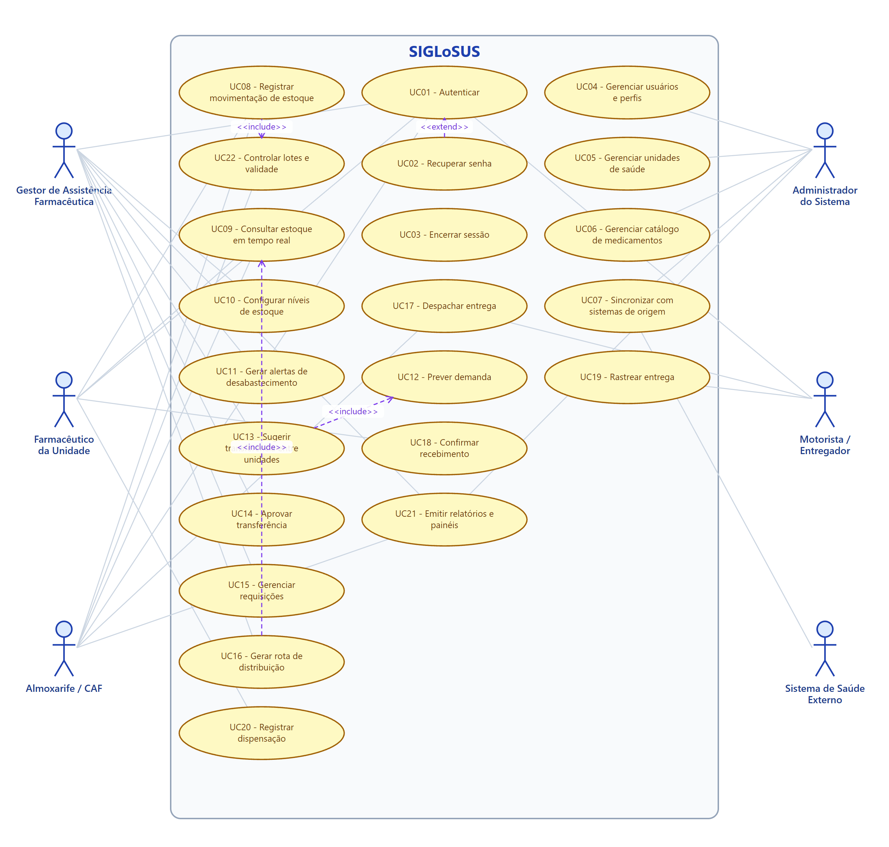

**Figura 1 – Diagrama de Casos de Uso do SIGLoSUS.**

> **Observação sobre as dependências (`<<include>>`):**
> - **UC13 (Sugerir transferência)** depende de **UC12 (Prever demanda)** — só é possível sugerir a redistribuição conhecendo a demanda futura.
> - **UC16 (Gerar rota)** depende de **UC09 (Consultar estoque em tempo real)** — a rota é montada a partir da posição consolidada de estoque.
> - **UC08 (Registrar movimentação)** depende de **UC22 (Controlar lotes e validade)** — toda movimentação respeita a regra FEFO.

## 3.2. Especificação dos Casos de Uso

### UC01 – Autenticar

| Campo | Descrição |
|---|---|
| **Nome do caso de uso** | UC01 – Autenticar |
| **Caso de uso geral** | Fluxo Principal |
| **Ator principal** | Usuário (qualquer perfil) |
| **Atores secundários** | N/A |
| **Resumo** | Descreve as etapas de acesso do usuário ao sistema por meio de login e senha. |
| **Pré-condições** | O usuário deve possuir cadastro ativo e acesso à internet. |
| **Pós-condições** | Sendo os dados válidos, o usuário é redirecionado ao painel inicial conforme o seu perfil. |

| Ações do Ator | Ações do Sistema |
|---|---|
| 1 – Informar e-mail (ou CPF) e senha | |
| | 2 – Validar as credenciais informadas |
| | 3 – Verificar o perfil de acesso do usuário |
| 4 – Confirmar o acesso | |
| | 5 – Registrar o acesso no log de auditoria e liberar a aplicação |

| Restrições/Validações |
|---|
| Se as credenciais forem inválidas, o acesso não é concedido. |
| O acesso é bloqueado temporariamente após 5 tentativas incorretas. |

**Tabela 1 – Especificação do caso de uso Autenticar.**

---

### UC07 – Sincronizar com sistemas de origem

| Campo | Descrição |
|---|---|
| **Nome do caso de uso** | UC07 – Sincronizar com sistemas de origem |
| **Caso de uso geral** | Fluxo Principal |
| **Ator principal** | Administrador do Sistema |
| **Atores secundários** | Sistema de Saúde Externo (e-SUS APS, HÓRUS/SNA, BNAFAR) |
| **Resumo** | Descreve a integração do SIGLoSUS com os sistemas já utilizados pela rede para importar/exportar dados de estoque e dispensação. |
| **Pré-condições** | As integrações devem estar configuradas e os serviços externos disponíveis. |
| **Pós-condições** | Os dados de estoque e dispensação são consolidados e ficam disponíveis para consulta em tempo real. |

| Ações do Ator | Ações do Sistema |
|---|---|
| 1 – Solicitar a sincronização (manual ou agendada) | |
| | 2 – Consultar os sistemas externos via API |
| | 3 – Receber os dados de estoque e dispensação |
| | 4 – Validar e conciliar os dados recebidos |
| | 5 – Atualizar a base consolidada de estoque |
| | 6 – Registrar o resultado e possíveis divergências da sincronização |

| Restrições/Validações |
|---|
| Se um sistema externo estiver indisponível, a última sincronização válida é mantida e o erro é registrado. |
| Dados divergentes são sinalizados para conferência manual. |

**Tabela 2 – Especificação do caso de uso Sincronizar com sistemas de origem.**

---

### UC09 – Consultar estoque em tempo real

| Campo | Descrição |
|---|---|
| **Nome do caso de uso** | UC09 – Consultar estoque em tempo real |
| **Caso de uso geral** | Fluxo Principal |
| **Ator principal** | Farmacêutico / Almoxarife / Gestor |
| **Atores secundários** | N/A |
| **Resumo** | Descreve a consulta consolidada da posição de estoque por medicamento e por unidade. |
| **Pré-condições** | O usuário deve estar autenticado e possuir dados de estoque sincronizados. |
| **Pós-condições** | O sistema apresenta a posição de estoque atualizada e os respectivos alertas. |

| Ações do Ator | Ações do Sistema |
|---|---|
| 1 – Selecionar filtros (medicamento, unidade, período) | |
| | 2 – Recuperar os dados consolidados de estoque |
| | 3 – Calcular a situação em relação aos níveis mínimo e de segurança |
| | 4 – Apresentar a posição de estoque e os alertas associados |

| Restrições/Validações |
|---|
| A consulta deve refletir a última sincronização realizada. |
| Medicamentos abaixo do nível mínimo são destacados visualmente. |

**Tabela 3 – Especificação do caso de uso Consultar estoque em tempo real.**

---

### UC13 – Sugerir transferência entre unidades

| Campo | Descrição |
|---|---|
| **Nome do caso de uso** | UC13 – Sugerir transferência entre unidades |
| **Caso de uso geral** | Fluxo Principal |
| **Ator principal** | Gestor de Assistência Farmacêutica |
| **Atores secundários** | N/A |
| **Resumo** | Descreve a geração automática de sugestões de redistribuição de medicamentos entre unidades com excedente e unidades com déficit. |
| **Pré-condições** | O estoque deve estar sincronizado e a previsão de demanda deve ter sido calculada (UC12). |
| **Pós-condições** | As sugestões de transferência ficam disponíveis para aprovação. |

| Ações do Ator | Ações do Sistema |
|---|---|
| 1 – Acessar o painel de redistribuição | |
| | 2 – Identificar unidades com excedente e unidades com déficit |
| | 3 – Verificar as regras de negócio (nível de segurança, FEFO, validade, proximidade) |
| | 4 – Calcular e apresentar as sugestões de transferência |
| 5 – Selecionar a sugestão desejada | |
| | 6 – Encaminhar a sugestão para aprovação (UC14) |

| Restrições/Validações |
|---|
| Não pode ser sugerida transferência de unidade com estoque abaixo do nível de segurança (RN01). |
| Medicamentos com validade inferior a 90 dias não podem ser transferidos (RN03). |

**Tabela 4 – Especificação do caso de uso Sugerir transferência entre unidades.**

---

### UC14 – Aprovar transferência

| Campo | Descrição |
|---|---|
| **Nome do caso de uso** | UC14 – Aprovar transferência |
| **Caso de uso geral** | Fluxo Principal |
| **Ator principal** | Gestor de Assistência Farmacêutica |
| **Atores secundários** | N/A |
| **Resumo** | Descreve a análise e a aprovação (ou rejeição) de uma transferência sugerida. |
| **Pré-condições** | Deve existir ao menos uma sugestão de transferência pendente. |
| **Pós-condições** | Aprovada, a transferência é registrada, a quantidade é baixada do estoque de origem (mercadoria em trânsito) e passa a compor as entregas a serem roteirizadas. O crédito no destino ocorre na confirmação de recebimento (UC18). |

| Ações do Ator | Ações do Sistema |
|---|---|
| 1 – Analisar a sugestão de transferência | |
| 2 – Aprovar ou rejeitar a sugestão | |
| | 3 – Validar as regras de negócio aplicáveis |
| | 4 – Registrar a decisão, atualizar a situação da transferência e dar baixa na origem |
| | 5 – Notificar as unidades envolvidas |

| Restrições/Validações |
|---|
| A aprovação exige a conferência das regras de negócio (RN01, RN03, RN08). |
| Uma transferência rejeitada retorna ao painel com a justificativa. |

**Tabela 5 – Especificação do caso de uso Aprovar transferência.**

---

### UC16 – Gerar rota de distribuição

| Campo | Descrição |
|---|---|
| **Nome do caso de uso** | UC16 – Gerar rota de distribuição |
| **Caso de uso geral** | Fluxo Principal |
| **Ator principal** | Gestor de Assistência Farmacêutica |
| **Atores secundários** | Almoxarife / CAF |
| **Resumo** | Descreve a geração de uma rota otimizada para a distribuição dos medicamentos até as unidades de destino. |
| **Pré-condições** | Deve haver transferências aprovadas ou requisições a entregar; veículo e motorista devem estar definidos. |
| **Pós-condições** | A rota é gerada, sequenciando as paradas, e fica disponível para despacho. |

| Ações do Ator | Ações do Sistema |
|---|---|
| 1 – Selecionar as unidades de destino e o veículo | |
| | 2 – Recuperar a posição de estoque e as prioridades (UC09) |
| | 3 – Calcular a melhor sequência de paradas (distância, prioridade, capacidade) |
| | 4 – Apresentar a rota com distância e tempo estimados |
| 5 – Confirmar a rota | |
| | 6 – Disponibilizar a rota para o despacho (UC17) |

| Restrições/Validações |
|---|
| A rota deve respeitar a capacidade de carga do veículo e a jornada do motorista (RN07). |
| Unidades com estoque abaixo do mínimo têm prioridade (RN04). |
| Em empate de prioridade, o abastecimento de medicamentos da RENAME é priorizado (RN06). |

**Tabela 6 – Especificação do caso de uso Gerar rota de distribuição.**

---

### UC18 – Confirmar recebimento

| Campo | Descrição |
|---|---|
| **Nome do caso de uso** | UC18 – Confirmar recebimento |
| **Caso de uso geral** | Fluxo Principal |
| **Ator principal** | Farmacêutico da Unidade |
| **Atores secundários** | Motorista / Entregador |
| **Resumo** | Descreve a conferência e a confirmação de que os medicamentos entregues foram recebidos pela unidade de destino. |
| **Pré-condições** | Deve existir uma entrega despachada para a unidade. |
| **Pós-condições** | O recebimento é registrado, o estoque da unidade é atualizado e a entrega é finalizada. |

| Ações do Ator | Ações do Sistema |
|---|---|
| | 1 – Apresentar os itens previstos na entrega, gerados a partir das transferências aprovadas |
| 2 – Conferir os itens e os lotes entregues | |
| 3 – Confirmar o recebimento (ou registrar divergência) | |
| | 4 – Creditar o estoque da unidade de destino e concluir as transferências vinculadas |
| | 5 – Encerrar a entrega e atualizar a situação da rota |

| Restrições/Validações |
|---|
| Havendo divergência de itens ou lotes, o recebimento é registrado com pendência e o gestor é notificado. |

**Tabela 7 – Especificação do caso de uso Confirmar recebimento.**

## 3.3. Diagramas de Sequência

Os diagramas de sequência detalham a interação entre os atores e os objetos do sistema nos casos de uso principais, seguindo o padrão **boundary → control → entity**.

### 3.3.1. Sequência – UC01 Autenticar

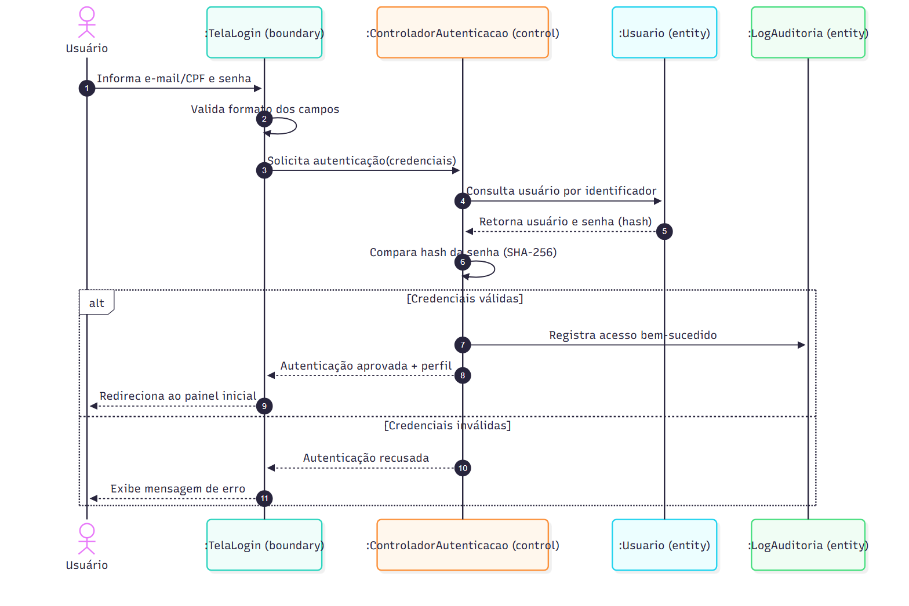

**Figura 2 – Sequência Autenticar.**

### 3.3.2. Sequência – UC07 Sincronizar com sistemas de origem

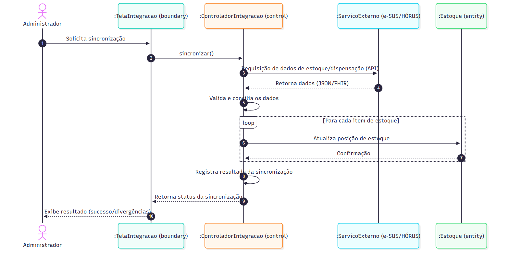

**Figura 3 – Sequência Sincronizar com sistemas de origem.**

### 3.3.3. Sequência – UC13/UC14 Sugerir e Aprovar Transferência

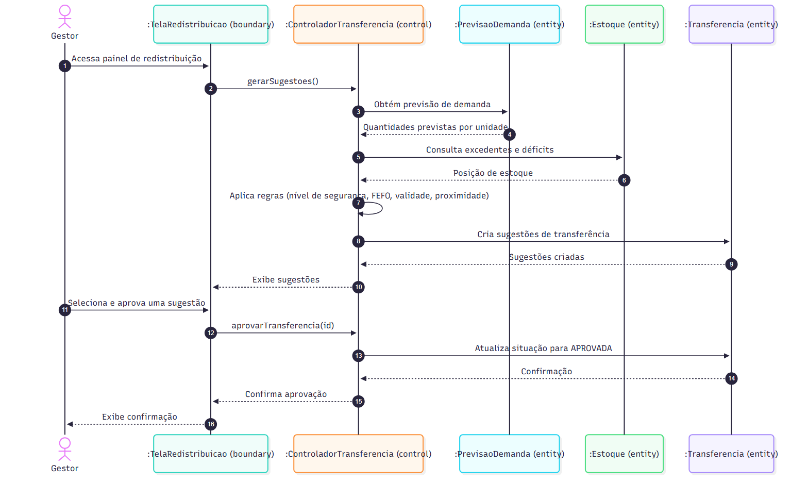

**Figura 4 – Sequência Sugerir e Aprovar Transferência.**

### 3.3.4. Sequência – UC16 Gerar rota de distribuição

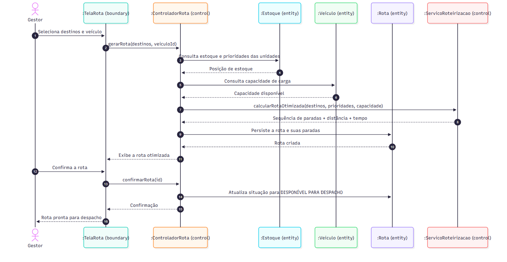

**Figura 5 – Sequência Gerar rota de distribuição.**

## 3.4. Diagramas de Atividades

### 3.4.1. Atividade – Monitoramento e reposição de estoque

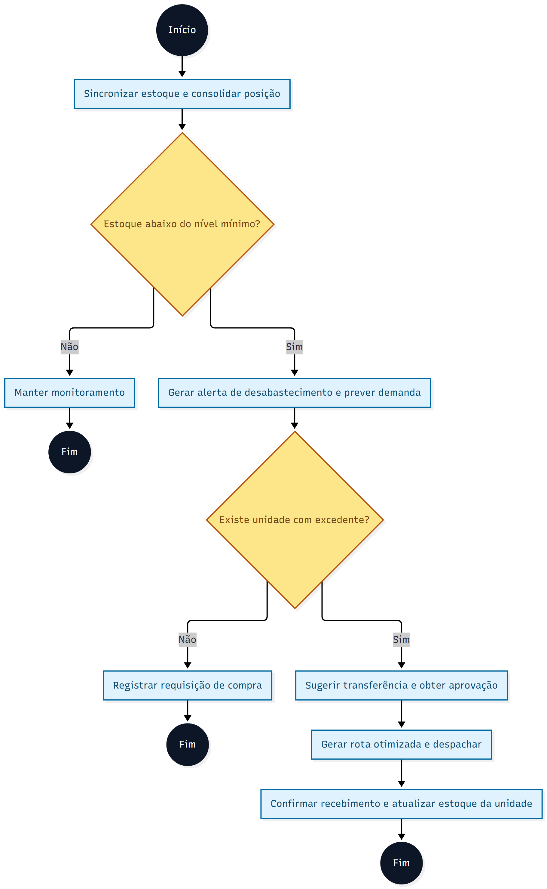

**Figura 6 – Atividade Monitoramento e reposição de estoque.**

### 3.4.2. Atividade – Geração de rota de distribuição

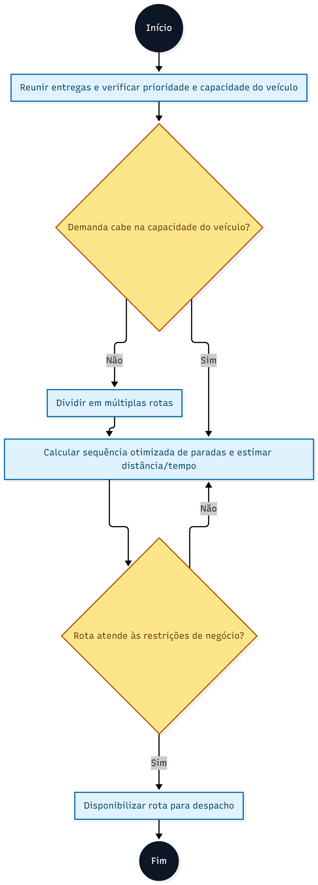

**Figura 7 – Atividade Geração de rota de distribuição.**

### 3.4.3. Atividade – Autenticação

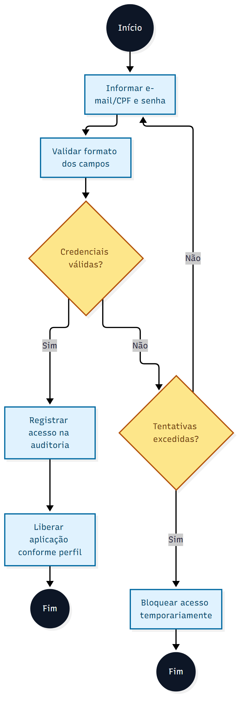

**Figura 8 – Atividade Autenticação.**

## 3.5. Diagrama de Classes

O diagrama de classes abaixo representa a estrutura estática do SIGLoSUS, com suas principais entidades, atributos, métodos e relacionamentos. A implementação em TypeScript (seção 4) materializa essas classes no pacote `src/domain/entities`, acrescentando apenas classes de apoio de granularidade menor (por exemplo, `EntregaItem`) e as enumerações centralizadas em `domain/enums.ts`.

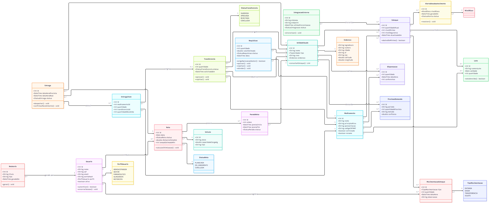

**Figura 9 – Diagrama de Classes do SIGLoSUS.**

---

# 4. Arquitetura

## 4.1. Visão Geral da Arquitetura

O SIGLoSUS foi implementado como uma aplicação **full-stack em Node.js com TypeScript**, organizada segundo uma **arquitetura em camadas** de inspiração *Clean Architecture*. A escolha atende diretamente aos requisitos não-funcionais de **manutenibilidade (RNF12)**, **interoperabilidade (RNF07)** e **escalabilidade (RNF08)**, além de tornar explícita a separação de responsabilidades exigida por um bom projeto de engenharia de software.

Os princípios arquiteturais adotados são:

- **Separação em camadas** — Apresentação, Aplicação, Domínio e Infraestrutura, com dependências apontando sempre para dentro (o Domínio não conhece a Infraestrutura);
- **Domínio rico** — entidades com comportamento (ex.: `Estoque.abaixoDoMinimo()`, `Lote.podeSerTransferido()`) e as nove regras de negócio centralizadas em `RegrasNegocio`;
- **Inversão de dependência** — as camadas superiores dependem de abstrações; a montagem concreta ocorre em um único ponto (o *Container* de injeção de dependência);
- **Padrão Repository** — o acesso a dados é abstraído por repositórios, permitindo trocar a persistência (memória → PostgreSQL) sem alterar o domínio;
- **Padrões de projeto (GoF)** — Singleton, Factory Method, Adapter, Observer e Strategy (detalhados na seção 5).

## 4.2. Arquitetura em Camadas

A Figura 10 apresenta as quatro camadas, as responsabilidades de cada uma e o sentido das dependências.

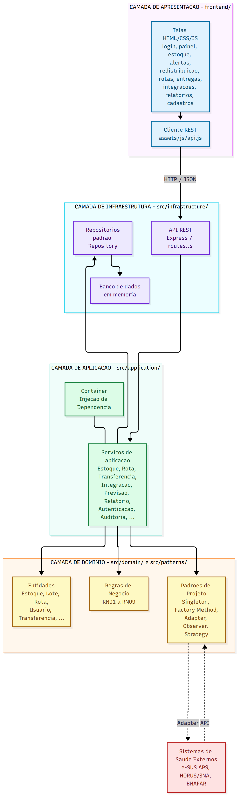

**Figura 10 – Arquitetura em camadas do SIGLoSUS.**

| Camada | Pacote (backend) | Responsabilidade | Depende de |
|---|---|---|---|
| **Apresentação** | `frontend/` | Telas HTML/CSS/JS e cliente REST (`api.js`). Exibe dados e captura ações do usuário. | Aplicação (via HTTP) |
| **Aplicação** | `src/application/` | Serviços que orquestram os casos de uso, o *Container* de injeção de dependência e a composição dos objetos. | Domínio, Infraestrutura |
| **Domínio** | `src/domain/` e `src/patterns/` | Entidades, enumerações, as 9 regras de negócio e os padrões de projeto. É o coração do sistema e **não depende de nada**. | — |
| **Infraestrutura** | `src/infrastructure/` | API REST (Express), repositórios, banco de dados em memória e carga inicial (*seed*). | Domínio |

O fluxo de uma requisição típica é: **Tela → HTTP (`routes.ts`) → Serviço de Aplicação → Regras de Negócio/Entidades → Repositório → Banco**. As respostas percorrem o caminho inverso.

## 4.3. Diagrama de Componentes

A Figura 11 mostra os principais componentes de software e suas interfaces.

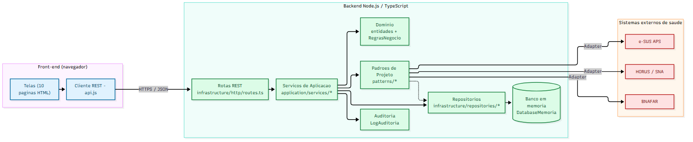

**Figura 11 – Diagrama de componentes do SIGLoSUS.**

Os componentes centrais são:

- **Rotas REST (`infrastructure/http/routes.ts`)** — expõe os endpoints `/api/*` que traduzem as operações em chamadas aos serviços;
- **Serviços de Aplicação** — `EstoqueService`, `TransferenciaService`, `RequisicaoService`, `RotaService`, `EntregaService`, `IntegracaoService`, `PrevisaoDemandaService`, `RelatorioService`, `AutenticacaoService`, `UsuarioService` e `AuditoriaService`;
- **Domínio** — entidades e `RegrasNegocio` (RN01 a RN09);
- **Padrões de Projeto** — `patterns/*`, consumidos pelos serviços;
- **Repositórios** — `UsuarioRepository`, `EstoqueRepository`, `RotaRepository`, entre outros, sobre o `DatabaseMemoria`.

## 4.4. Diagrama de Implantação

A Figura 12 representa a implantação física da solução. Para a demonstração acadêmica, o backend e o front-end estático residem no mesmo processo Node.js; em produção, o banco em memória é substituído por um SGBD e o front-end pode ser servido por um CDN ou servidor web dedicado.

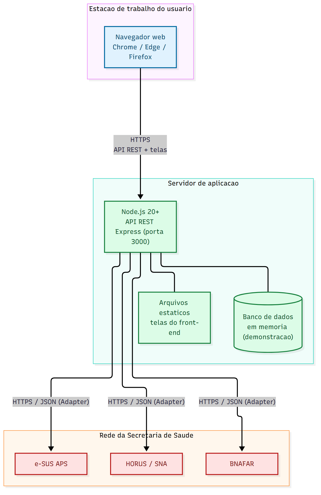

**Figura 12 – Diagrama de implantação do SIGLoSUS.**

| Nó | Tecnologia | Observação |
|---|---|---|
| Estação do usuário | Navegador web moderno | Acessa a API REST e as telas via HTTPS. |
| Servidor de aplicação | Node.js 20+ / Express | Executa a API na porta 3000 e serve as telas estáticas. |
| Banco de dados | Em memória (demonstração) | Substituível por PostgreSQL sem alterar o domínio (padrão Repository). |
| Sistemas externos | e-SUS APS, HÓRUS/SNA, BNAFAR | Acessados por HTTPS/JSON por meio dos adaptadores (padrão Adapter). |

## 4.5. Padrão Repository e Injeção de Dependência

O **padrão arquitetural Repository** isola o domínio dos detalhes de persistência. Todos os repositórios herdam de `RepositorioBase<T>`, que oferece operações genéricas (`listar`, `buscarPorId`, `salvar`, `remover`) sobre o `DatabaseMemoria`:

```typescript
export abstract class RepositorioBase<T extends { id: number }> {
  constructor(
    protected readonly db: DatabaseMemoria,
    protected readonly nomeColecao: string,
    protected readonly obterColecao: () => T[],
  ) {}

  listar(): T[] { return [...this.obterColecao()]; }
  buscarPorId(id: number): T | undefined { return this.obterColecao().find((i) => i.id === id); }
  salvar(item: T): T { this.obterColecao().push(item); return item; }
  proximoId(): number { return this.db.proximoId(this.nomeColecao); }
}
```

A **injeção de dependência** é feita de forma explícita no *composition root* (`application/Container.ts`), que instancia o banco, os repositórios, registra os observadores (padrão Observer) e constrói os serviços. Esse é o único ponto que conhece as classes concretas, o que facilita testes (basta injetar um contêiner novo) e a substituição de implementações.

## 4.6. Organização do Repositório

```
SIGLoSUS---Engenharia-de-Software/
├── README.md                     # Visão geral do projeto
├── CONTRIBUTING.md               # Práticas de versionamento (Git Flow, commits semânticos)
├── .gitignore
├── pasta 01/                     # Entrega da Parte 1 (documentação e diagramas UML)
└── pasta 02/                     # Entrega da Parte 2
    ├── docs/                     # Documentação completa (este documento) + HTML/PDF
    ├── diagramas/                # Fontes Mermaid das figuras das seções 4 e 5
    ├── imagens/                  # Figuras renderizadas (UML, arquitetura, padrões e telas)
    └── siglosus/
        ├── backend/              # API REST em Node.js + TypeScript
        │   ├── src/
        │   │   ├── domain/       # Entidades, enums e regras de negócio (RN01–RN09)
        │   │   ├── patterns/     # Singleton, Factory Method, Adapter, Observer, Strategy
        │   │   ├── application/  # Serviços de aplicação e Container (injeção de dependência)
        │   │   └── infrastructure/ # HTTP (Express), repositórios, banco e seed
        │   ├── tests/            # Testes automatizados (Vitest + Supertest)
        │   └── package.json
        └── frontend/             # Telas (seção 6) — protótipos navegáveis
            ├── index.html        # Login
            ├── dashboard.html    # Painel
            ├── estoque.html      # Estoque
            ├── alertas.html      # Alertas
            ├── redistribuicao.html
            ├── rotas.html
            ├── entregas.html
            ├── integracoes.html
            ├── relatorios.html
            ├── cadastros.html
            └── assets/           # CSS e JavaScript (cliente REST e páginas)
```

**Como executar o software:**

```bash
# Backend (API REST + telas) — Node.js 20+
cd "pasta 02/siglosus/backend"
npm install
npm start          # sobe em http://localhost:3000
npm test           # executa os 45 testes automatizados
```

Acesse `http://localhost:3000/` no navegador. Usuários de demonstração (senha `siglosus123`): `gestor@siglosus.gov.br`, `farmaceutico@siglosus.gov.br`, `almoxarife@siglosus.gov.br`, `motorista@siglosus.gov.br`, `admin@siglosus.gov.br`.

## 4.7. Rastreabilidade: Requisitos × Componentes

A Tabela 8 relaciona os requisitos funcionais aos componentes de software que os implementam, evidenciando a **compatibilidade entre a documentação e o software**.

**Tabela 8 – Rastreabilidade entre requisitos funcionais e componentes do software.**

| Requisito | Componente / Classe | Endpoint (API) |
|---|---|---|
| RF01, RF02, RF03 | `AutenticacaoService`, `Usuario` | `POST /api/auth/login` |
| RF04 | `UsuarioService`, `UsuarioRepository` | `GET/POST /api/usuarios`, `PATCH /api/usuarios/:id/inativar` |
| RF05 | `UnidadeSaude`, `UnidadeRepository` | `GET /api/unidades` |
| RF06 | `Medicamento`, `MedicamentoRepository` | `GET /api/medicamentos` |
| RF07 | `IntegracaoService` + Adapters (e-SUS, HÓRUS, BNAFAR) | `GET /api/integracoes`, `POST /api/integracoes/sincronizar` |
| RF08 | `EstoqueService`, `MovimentacaoEstoque` | `POST /api/estoque/movimentacoes` |
| RF09 | `EstoqueService.consolidado()` | `GET /api/estoque` |
| RF10 | `EstoqueService.configurarNiveis()` | `PATCH /api/estoque/:id/niveis` |
| RF11 | `AlertaService` + `AlertaDesabastecimentoObserver` (Observer) | `GET /api/alertas`, `PATCH /api/alertas/:id/resolver` |
| RF12 | `PrevisaoDemandaService` | `POST /api/previsoes/gerar`, `GET /api/previsoes` |
| RF13, RF14 | `TransferenciaService`, `EstoqueService` | `POST /api/transferencias/sugerir`, `POST /api/transferencias/:id/aprovar` |
| RF15, RF16 | `RotaService` + Strategy | `POST /api/rotas`, `POST /api/rotas/:id/despachar` |
| RF17 | `EntregaService`, `EntregaItem` | `GET /api/entregas`, `POST /api/entregas/:id/confirmar` |
| RF18 | `Lote`, `RegrasNegocio` (RN02 FEFO) | (interno ao `EstoqueService`) |
| RF19 | `DispensacaoService`, `Dispensacao` (RN05) | `GET/POST /api/dispensacoes` |
| RF20 | `RequisicaoService`, `Requisicao` (RN09) | `GET/POST /api/requisicoes`, `POST /api/requisicoes/:id/aprovar`, `POST /api/requisicoes/:id/rejeitar` |
| RF21 | `RelatorioService` | `GET /api/relatorios/dashboard`, `POST /api/relatorios` |
| RF22 | `AuditoriaService`, `LogAuditoria` | `GET /api/auditoria` |

---

# 5. Padrões de Projeto

## 5.1. Visão Geral

Foram aplicados **cinco padrões de projeto** (*Design Patterns*) do catálogo *Gang of Four*, escolhidos por resolverem problemas concretos do domínio do SIGLoSUS. Cada padrão está implementado no pacote `src/patterns/` e é exercitado por testes automatizados.

| # | Padrão | Categoria | Problema que resolve no SIGLoSUS |
|---|---|---|---|
| 1 | **Singleton** | Criacional | Garantir uma única instância de configuração compartilhada por toda a aplicação. |
| 2 | **Factory Method** | Criacional | Criar notificações por diferentes canais (e-mail, SMS, push) sem acoplar o chamador às classes concretas. |
| 3 | **Adapter** | Estrutural | Integrar sistemas de saúde legados com formatos de dados incompatíveis (e-SUS, HÓRUS, BNAFAR). |
| 4 | **Observer** | Comportamental | Reagir automaticamente às movimentações de estoque (gerar alertas e notificações). |
| 5 | **Strategy** | Comportamental | Alternar algoritmos de roteirização em tempo de execução. |

## 5.2. Singleton

**Intenção:** garantir que uma classe tenha **apenas uma instância** e fornecer um ponto de acesso global a ela.

**Aplicação:** a classe `ConfiguracaoSistema` centraliza os parâmetros de negócio usados por várias camadas — o limite de aprovação do gestor (RN09), a validade mínima para transferência (RN03, 90 dias), a jornada máxima do motorista (RN07) e a porta do servidor. Como esses valores precisam ser **consistentes em toda a aplicação**, uma instância única evita divergências.

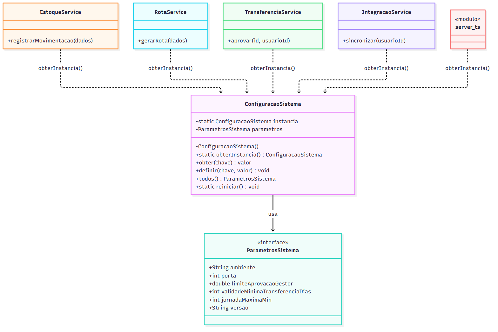

**Figura 13 – Padrão Singleton aplicado à configuração do sistema.**

```typescript
export class ConfiguracaoSistema {
  private static instancia: ConfiguracaoSistema | null = null;
  private constructor() { /* carrega os parâmetros */ }

  static obterInstancia(): ConfiguracaoSistema {
    if (ConfiguracaoSistema.instancia === null) {
      ConfiguracaoSistema.instancia = new ConfiguracaoSistema();
    }
    return ConfiguracaoSistema.instancia;
  }
}
```

**Rastreabilidade:** RNF12 (manutenibilidade) e RN03, RN07, RN09.

## 5.3. Factory Method

**Intenção:** definir uma interface para criar um objeto, mas deixar as subclasses decidirem qual classe concreta instanciar.

**Aplicação:** o SIGLoSUS envia notificações por diferentes canais. A fábrica abstrata `NotificacaoFactory` declara `criarNotificacao()`; as subclasses `NotificacaoEmailFactory`, `NotificacaoSmsFactory` e `NotificacaoPushFactory` decidem qual produto criar. O chamador usa apenas `notificar(destinatario, mensagem)`, sem conhecer as classes concretas.

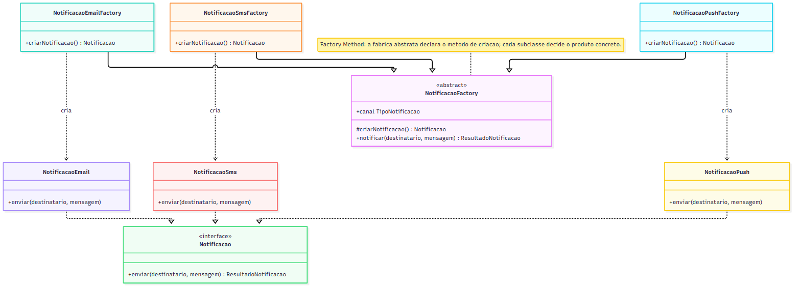

**Figura 14 – Padrão Factory Method aplicado às notificações.**

**Rastreabilidade:** RF11 (alertas) e RF07 (notificação de sincronização/ocorrências).

## 5.4. Adapter

**Intenção:** converter a interface de uma classe em outra interface que o cliente espera, permitindo que classes com interfaces incompatíveis trabalhem juntas.

**Aplicação:** cada sistema de saúde legado expõe os dados em um formato próprio (`co_catmat`, `saldo`, `batch`…). A interface-alvo `SistemaSaudeAdapter` define o contrato conhecido pelo domínio (`obterEstoque()` e `exportarEstoque()`), e os adaptadores `ESUSAPSAdapter`, `HorusAdapter` e `BnafarAdapter` traduzem os formatos para o registro canônico `RegistroEstoqueExterno`.

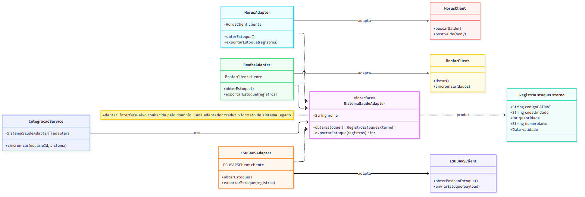

**Figura 15 – Padrão Adapter aplicado à integração com sistemas de saúde.**

**Rastreabilidade:** RF07 e RNF07 (interoperabilidade).

## 5.5. Observer

**Intenção:** definir uma dependência um-para-muitos entre objetos, de modo que quando um objeto muda de estado, todos os seus dependentes sejam notificados automaticamente.

**Aplicação:** o `EstoqueSubject` mantém a lista de observadores e os notifica a cada movimentação. O `AlertaDesabastecimentoObserver` gera um alerta quando o estoque fica abaixo do mínimo (RF11), e o `NotificacaoEstoqueObserver` envia a notificação ao gestor — este último **combina** o Observer com o Factory Method.

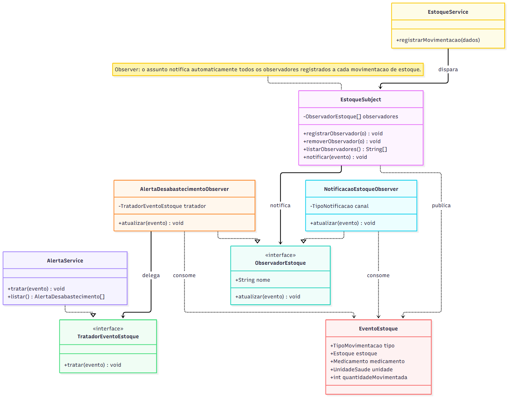

**Figura 16 – Padrão Observer aplicado ao monitoramento de estoque.**

**Rastreabilidade:** RF11 (alertas automáticos de desabastecimento).

## 5.6. Strategy

**Intenção:** definir uma família de algoritmos, encapsulá-los e torná-los intercambiáveis em tempo de execução.

**Aplicação:** há várias formas de ordenar as paradas de uma rota. Cada algoritmo é uma estratégia: `RotaMenorDistancia` (RN08), `RotaPorPrioridade` (RN04) e `RotaCapacidadeVeiculo` (RN07). O contexto `Roteirizador` recebe a estratégia e pode trocá-la dinamicamente, sem alterar o código cliente.

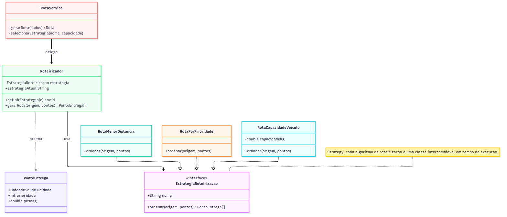

**Figura 17 – Padrão Strategy aplicado à roteirização de entregas.**

**Rastreabilidade:** RF15 (rotas otimizadas) e RN04, RN07, RN08.

## 5.7. Resumo e Rastreabilidade dos Padrões

**Tabela 9 – Resumo dos padrões de projeto, classes e testes.**

| Padrão | Classes principais | Arquivo | Requisitos/Regras | Teste automatizado |
|---|---|---|---|---|
| Singleton | `ConfiguracaoSistema` | `patterns/singleton/ConfiguracaoSistema.ts` | RNF12, RN03, RN07, RN09 | `padroes-projeto.test.ts` |
| Factory Method | `NotificacaoFactory`, `Notificacao*Factory`, `Notificacao*` | `patterns/factory/NotificacaoFactory.ts` | RF11 | `padroes-projeto.test.ts` |
| Adapter | `SistemaSaudeAdapter`, `ESUSAPSAdapter`, `HorusAdapter`, `BnafarAdapter` | `patterns/adapter/*.ts` | RF07, RNF07 | `padroes-projeto.test.ts` |
| Observer | `EstoqueSubject`, `AlertaDesabastecimentoObserver`, `NotificacaoEstoqueObserver` | `patterns/observer/*.ts` | RF11 | `padroes-projeto.test.ts`, `servicos.test.ts` |
| Strategy | `EstrategiaRoteirizacao`, `RotaMenorDistancia`, `RotaPorPrioridade`, `RotaCapacidadeVeiculo`, `Roteirizador` | `patterns/strategy/EstrategiaRoteirizacao.ts` | RF15, RN04, RN07, RN08 | `padroes-projeto.test.ts` |

A suíte de testes (**45 testes** em 4 arquivos) comprova o funcionamento das regras de negócio, dos padrões de projeto, dos serviços de aplicação, da API REST e dos códigos de status HTTP:

| Arquivo de teste | Cobertura |
|---|---|
| `tests/regras-negocio.test.ts` | RN01 a RN09 (10 testes) |
| `tests/padroes-projeto.test.ts` | Singleton, Factory Method, Adapter, Observer e Strategy (7 testes) |
| `tests/servicos.test.ts` | Autenticação, estoque, RF14/RF17, RF19/RN05, RN06, RN09, rotas, entregas, integração, previsão e painel (14 testes) |
| `tests/api.test.ts` | Endpoints REST, RF19, RF20/RN09, ausência de `senhaHash`, 401/404/423 (14 testes) |

---

# 6. Prototipação das Telas

## 6.1. Considerações Gerais

As telas do SIGLoSUS foram prototipadas como **aplicação web navegável** e estão implementadas em `pasta 02/siglosus/frontend`. Diferentemente de um protótipo estático, estas telas **consomem a API REST real** (seção 4), de modo que os dados exibidos (estoque, alertas, rotas, entregas) são produzidos pelo backend em execução — o que reforça a compatibilidade entre documentação, arquitetura, padrões e software.

O layout é composto por um **menu lateral fixo** com as nove áreas funcionais, uma **barra superior** com o título da tela e o usuário autenticado, e uma **área de conteúdo** com cartões, tabelas e formulários. A paleta de cores (azul/teal) e os ícones remetem ao contexto de saúde pública. A interface é responsiva e foi projetada buscando o nível AA das diretrizes WCAG 2.1 (RNF06).

## 6.2. Tela de Acesso

Tela de login (UC01 / RF01). O usuário informa e-mail (ou CPF) e senha; as credenciais são validadas no backend e, em caso de sucesso, o usuário é direcionado ao painel conforme o seu perfil. Após cinco tentativas incorretas, o acesso é bloqueado temporariamente.

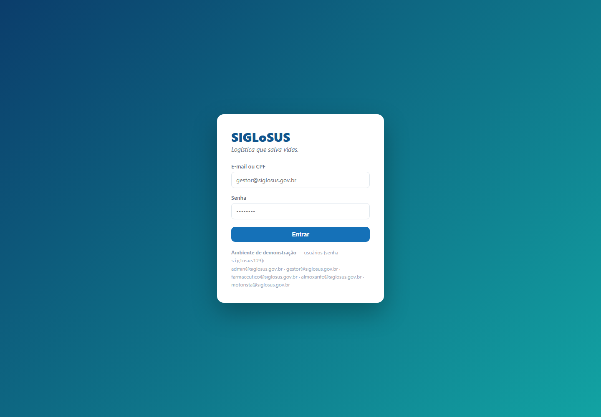

**Figura 18 – Tela de acesso (login).**

## 6.3. Painel Gerencial

Painel inicial (RF21) com os principais indicadores: unidades atendidas, itens monitorados, itens críticos e alertas abertos. Apresenta a lista de itens em nível crítico, os alertas de desabastecimento e um atalho para sincronizar com os sistemas de origem (UC07).

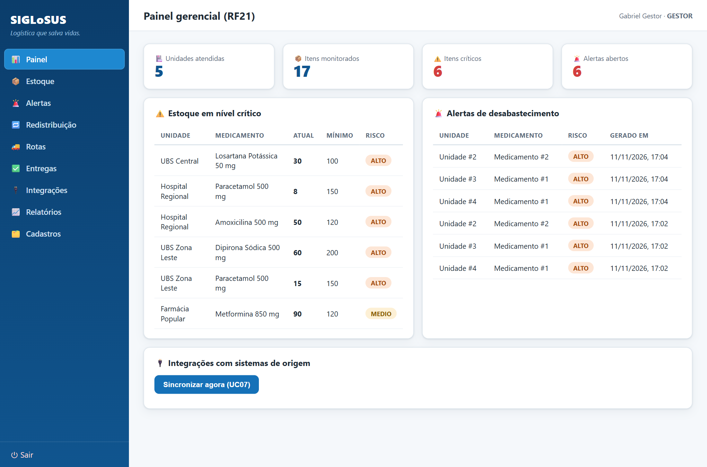

**Figura 19 – Painel gerencial (dashboard).**

## 6.4. Estoque em Tempo Real

Consulta consolidada da posição de estoque (UC09 / RF09), com filtros por unidade, medicamento e situação crítica. A tela também permite registrar movimentações (RF08); cada movimentação dispara o padrão Observer, que pode gerar um alerta automaticamente.

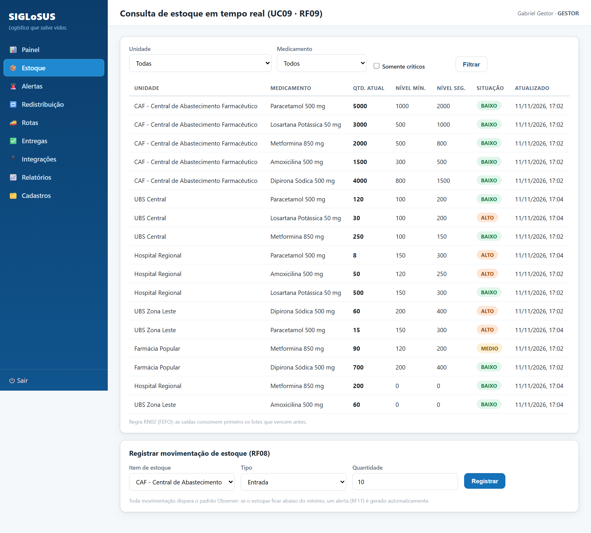

**Figura 20 – Tela de estoque em tempo real.**

## 6.5. Alertas de Desabastecimento

Lista os alertas gerados automaticamente (RF11), classificados por nível de risco (baixo, médio, alto e crítico). O gestor pode marcar um alerta como resolvido.

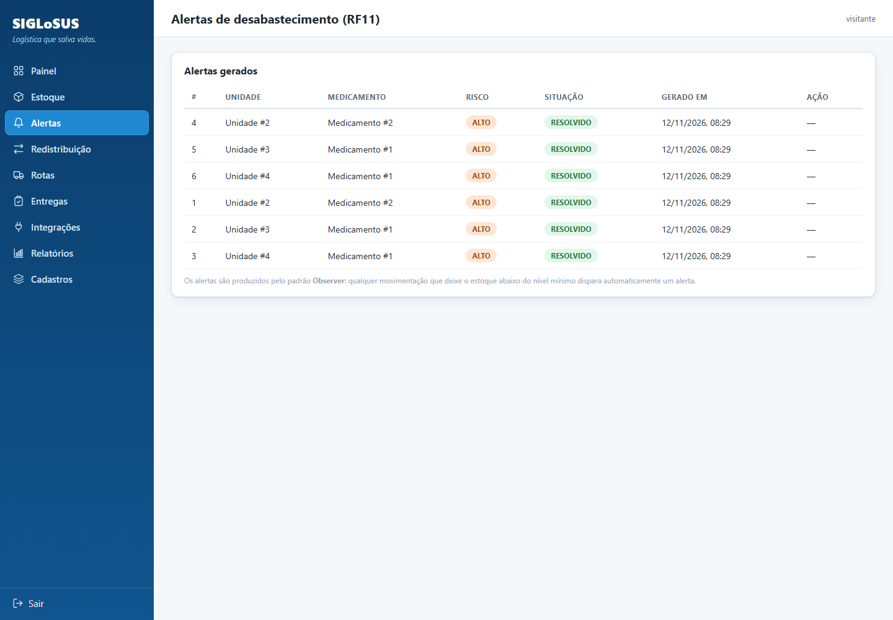

**Figura 21 – Tela de alertas de desabastecimento.**

## 6.6. Redistribuição entre Unidades

Painel de redistribuição (UC13/UC14 · RF13/RF14). Ao clicar em *Gerar sugestões*, o sistema identifica unidades com excedente e unidades com déficit e propõe transferências, respeitando RN01 (nível de segurança), RN03 (validade ≥ 90 dias) e RN08 (proximidade). O gestor pode aprovar ou rejeitar cada sugestão. A aprovação dá baixa imediata no estoque de origem (mercadoria em trânsito); o crédito no destino ocorre quando a entrega é recebida.

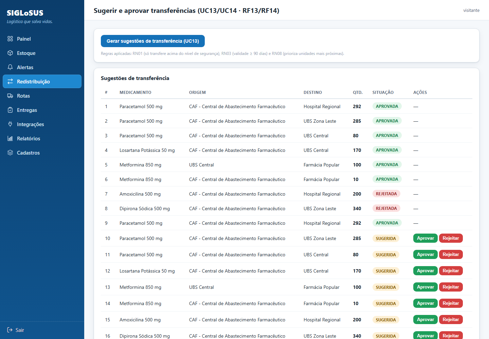

**Figura 22 – Tela de redistribuição entre unidades.**

## 6.7. Rotas de Distribuição

Geração de rotas otimizadas (UC16 · RF15). O usuário escolhe o veículo, as unidades de destino e a **estratégia** (padrão Strategy: menor distância, prioridade ou capacidade do veículo). O sistema apresenta a sequência de paradas, a distância total e o tempo estimado, e permite despachar a rota (UC17). Na estratégia por prioridade, unidades com medicamentos da RENAME em déficit recebem desempate favorável (RN06).

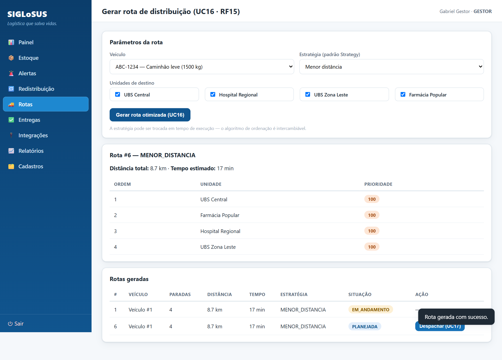

**Figura 23 – Tela de rotas de distribuição.**

## 6.8. Entregas

Acompanhamento e confirmação de recebimento das entregas (UC18 · RF17). Ao despachar a rota, o sistema gera os itens previstos a partir das transferências aprovadas para cada unidade. Ao confirmar, o estoque da unidade de destino é creditado com esses itens (o servidor não confia em quantidades enviadas pelo cliente), as transferências vinculadas são concluídas e a rota é encerrada quando todas as paradas terminam; havendo divergência, o recebimento é registrado com pendência e o gestor é notificado.

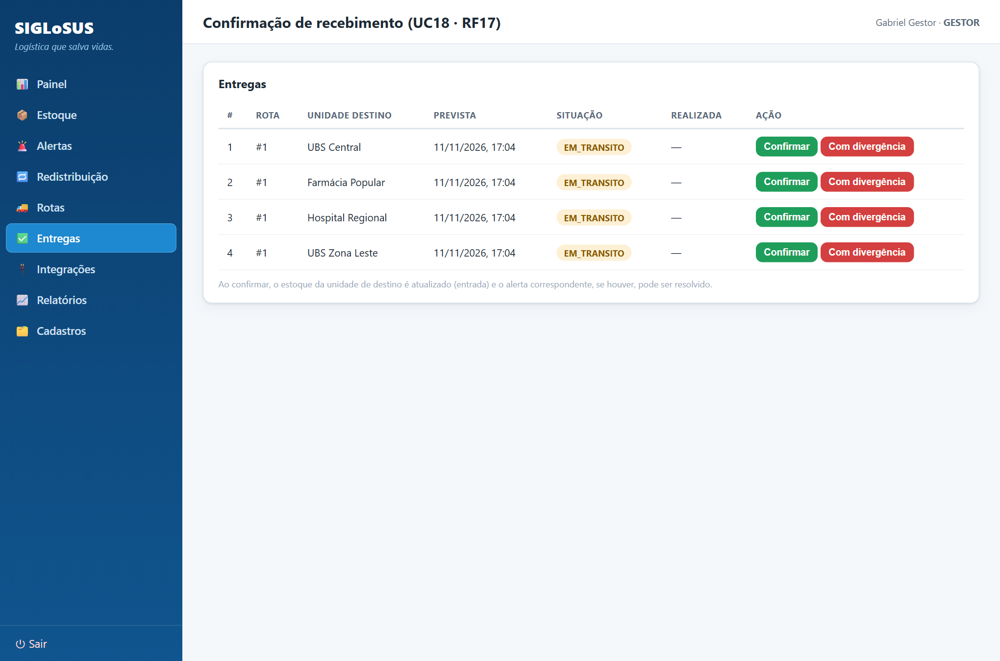

**Figura 24 – Tela de entregas.**

## 6.9. Integrações

Configuração e execução da sincronização com os sistemas de saúde externos (UC07 · RF07), evidenciando o padrão **Adapter**. A tela mostra os sistemas configurados, a situação de cada integração, a última sincronização e o resultado da sincronização (registros atualizados e divergências).

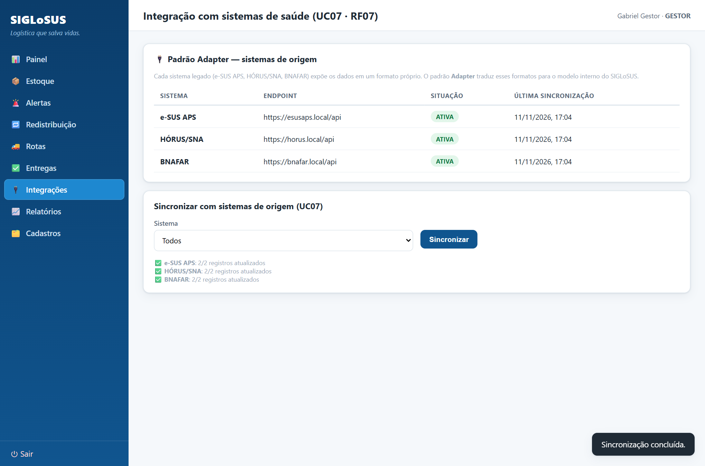

**Figura 25 – Tela de integrações com sistemas de saúde.**

## 6.10. Relatórios

Indicadores gerenciais (RF21) e geração de previsões de demanda (RF12). O usuário escolhe o período (30, 60 ou 90 dias) e o sistema calcula a quantidade prevista por unidade/medicamento, informando o método e a confiança da previsão.

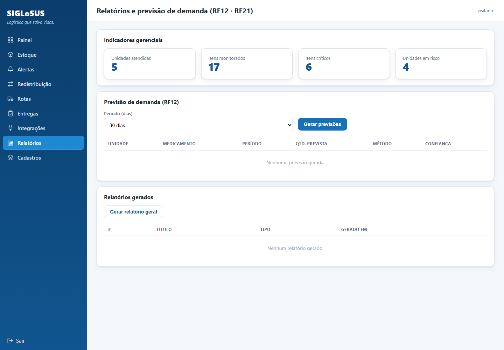

**Figura 26 – Tela de relatórios e previsão de demanda.**

## 6.11. Cadastros

Cadastros e administração: usuários e perfis (RF04), unidades de saúde (RF05), catálogo de medicamentos (RF06) e a trilha de auditoria das operações críticas (RF22 · RNF10).

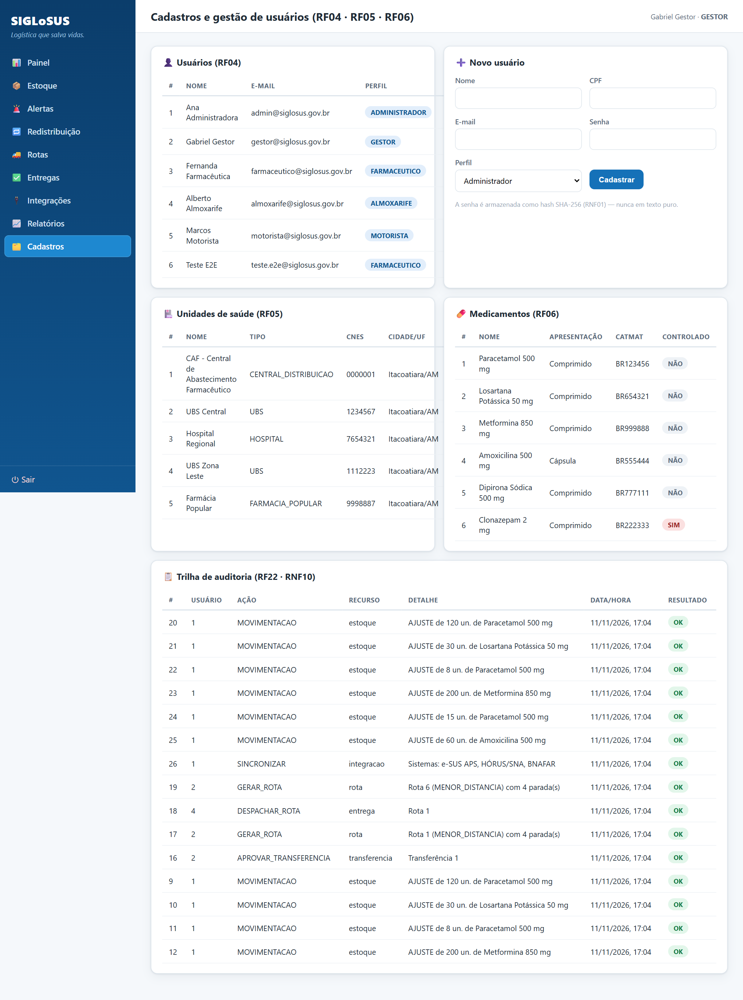

**Figura 27 – Tela de cadastros e auditoria.**

## 6.12. Mapa de Navegação e Rastreabilidade

A Tabela 10 relaciona cada tela prototipada aos casos de uso e requisitos correspondentes, fechando a rastreabilidade entre a prototipação (seção 6), os requisitos (seção 2), os diagramas (seção 3), a arquitetura (seção 4) e os padrões (seção 5).

**Tabela 10 – Rastreabilidade entre telas, casos de uso, requisitos e padrões.**

| Tela | Casos de uso | Requisitos | Regras | Padrões evidenciados |
|---|---|---|---|---|
| Login | UC01 | RF01, RF02, RF03 | — | — |
| Painel | UC07, UC09 | RF21, RF09, RF11 | RN04 | Observer, Adapter |
| Estoque | UC08, UC09 | RF08, RF09, RF10, RF18 | RN01, RN02 | Observer |
| Alertas | UC11 | RF11 | — | Observer, Factory Method |
| Redistribuição | UC13, UC14 | RF13, RF14 | RN01, RN03, RN08 | — |
| Rotas | UC16 | RF15, RF16 | RN04, RN06, RN07, RN08 | Strategy |
| Entregas | UC17, UC18 | RF16, RF17 | RN02 | Observer |
| Integrações | UC07 | RF07 | — | Adapter |
| Relatórios | UC12 | RF12, RF21 | — | — |
| Cadastros | UC01, UC04 | RF04, RF05, RF06, RF22 | — | Singleton |

**Navegação:** todas as telas são acessíveis a partir do menu lateral; a tela de login é a porta de entrada. O menu é composto por: **Painel · Estoque · Alertas · Redistribuição · Rotas · Entregas · Integrações · Relatórios · Cadastros**.

**Observação sobre RF19 e RF20:** a dispensação ao paciente (`/api/dispensacoes`, RF19/RN05) e a gestão de requisições (`/api/requisicoes`, RF20/RN09) estão implementadas como API REST. Nesta entrega não foram criadas telas dedicadas para esses dois fluxos; a prototipação cobre o caminho operacional de redistribuição entre unidades (RF13/RF14), que dialoga diretamente com a distribuição demonstrada nas telas de rotas e entregas.

---

## Referências

BRASIL. Ministério da Saúde. **Materiais de referência da disciplina de Engenharia de Software**. Itacoatiara: UFAM/ICET, 2026.

GAMMA, Erich; HELM, Richard; JOHNSON, Ralph; VLISSIDES, John. **Padrões de projeto: soluções reutilizáveis de software orientado a objetos**. Porto Alegre: Bookman, 2000.

MARTIN, Robert C. **Arquitetura limpa: o guia do artesão para estrutura e design de software**. Rio de Janeiro: Alta Books, 2019.

PRESSMAN, Roger S. **Engenharia de software: uma abordagem profissional**. 7. ed. Porto Alegre: AMGH, 2011.

SOMMERVILLE, Ian. **Engenharia de software**. 9. ed. São Paulo: Pearson Addison-Wesley, 2011.

---

*Documento completo (Partes 1 e 2) do projeto SIGLoSUS — Engenharia de Software B.*
